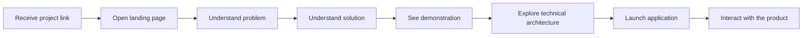
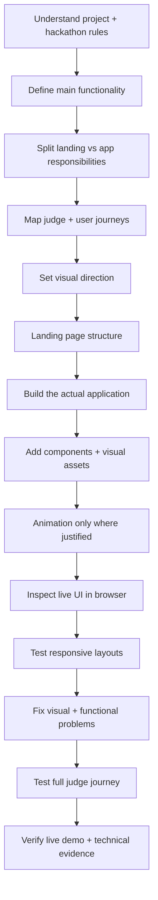

# HACKATHON_LANDING_PAGE_AND_FRONTEND_TOOLING.md

> **What this is:** a practical guide to presenting a hackathon project (the pitch), building the working app (the proof), and the frontend skills/tools that can help — then (§I) what that means for **Wayproof** specifically.
> **Status:** documentation only. **Nothing has been installed.** Every install command is listed for review; none is approved.
> **Labels:** **VERIFIED** (checked against an official/source page on 16 Nov 2026) · **UNVERIFIED** (from your notes; source could not be opened or differs) · **RECOMMENDATION** · **ASSUMED** · **NEEDS CONFIRMATION**.
> Related: `PRODUCT_SURFACE_MAP.md` (surfaces, routes, judge journey) · `docs/03-WIREFRAMES-UI-SPEC.md` (screens, tokens) · `hackathon.md` (rules) · `TDD.md` (frontend stack §9).

---

## A. Hackathon product presentation architecture

> **The landing page is the pitch. The main application is the proof. Technical evidence establishes credibility.**

### A.1 Landing page — the pitch
Its job is to make a visitor *want to try the product*. It answers, in order:
1. What we built · 2. What problem it solves · 3. Who it is for · 4. Why the problem matters · 5. How the solution works · 6. What makes it different · 7. Why the technology is interesting · 8. What results/impact it delivers · 9. **How judges can try it**.

### A.2 Main application — the proof
Where judges and users actually use the working product. Typical areas (include **only** those the project needs): dashboard, core functionality, analytics, portfolio, AI features, Web3 features, settings. A beautiful landing page with a weak app loses; a plain landing page with a working app can win.

### A.3 Technical evidence — credibility
Shows the work is real: system architecture diagram, APIs, AI models and how they are used, smart contracts / blockchain infrastructure (if any), database, automation, AI agents, key technical decisions, the **GitHub repository**, and a **live demonstration** (plus a recorded fallback).

### A.4 Landing page vs marketing website
| | Landing page | Marketing website |
|---|---|---|
| Size | Usually **one focused page** | Many pages (features, pricing, blog, about, docs…) |
| Goal | **One primary action** (e.g. "Try it") | Serve many audiences and purposes |
| Effort | Hours | Days–weeks |

**Why a landing page usually wins at a hackathon:** judges have minutes, not hours; every page you add is time taken from the core product; one page with one clear action is easier to understand and to keep accurate.

---

## B. Recommended landing page structure

Use the sections that fit; each one hands off to the next.

| # | Section | Purpose | Communicates | Possible content | Audience | Leads to |
|---|---|---|---|---|---|---|
| 1 | Navigation & branding | Orient | Name, where things are | Wordmark, 2–4 links, **Launch / Try it** button | Everyone | Hero |
| 2 | Hero | Hook in seconds | What it is + for whom + main action | One-sentence promise, sub-line, primary CTA, product visual | Everyone | Problem |
| 3 | Problem | Make the pain real | Who suffers and why it matters | Short scenario, 1–3 facts **with sources** | Judges, users | Solution |
| 4 | Solution | Show the answer | What the product does | 2–3 sentences, simple diagram | Everyone | Demo |
| 5 | Product demonstration | Prove it works | Real output | Video, GIF, screenshots of **real** results | Judges | Features |
| 6 | Key features | Scan value | 3–5 capabilities | Feature rows/cards | Users | How it works |
| 7 | How it works | Build understanding | Steps of the flow | Numbered steps / flow diagram | Everyone | Architecture |
| 8 | Architecture & tech explanation | Credibility | Components and why | Architecture diagram, decisions | Technical judges | Stack |
| 9 | Technology stack | Show sponsor/tech use | Tools and their role | Logos/names with *what each does* | Judges, sponsors | Results |
| 10 | Results & impact | Show outcomes | What it found/changed | Real numbers, real examples | Judges | Resources |
| 11 | GitHub & resources | Let people verify | Repo, docs, video | Links | Technical judges | Final CTA |
| 12 | Final call to action | Convert | "Try it now" | Repeat primary CTA | Everyone | App |
| 13 | Footer | Close | Team, license, links | Credits, hackathon name | Everyone | — |

**30–60 second guideline:** aim for a judge to grasp *what it is, who it's for and why it matters* within roughly 30–60 seconds of reading the top of the page. This is a presentation target, **not a guaranteed outcome** — test it on someone who hasn't seen the project.

---

## C. The judge experience

| Stage | Judge should understand |
|---|---|
| Open landing page | What this is, in one sentence |
| Problem | Who has this problem and why it matters |
| Solution | What the product does about it |
| Demonstration | That it really works (real output) |
| Architecture | How it's built; how sponsor tech is used |
| Launch application | Where to click, what to expect, any limits |
| Interact | They can complete the main task themselves |

**Usability requirements:** clear navigation · an obvious **Launch App / Try it** button · every link works · demo accessible without setup · **no misleading claims** · **no fake functionality** · no unnecessary registration · limitations stated plainly · reliable app entry (with a fallback if the live app fails).

The landing page **sells** the product; the application **proves** it.

---

## D. Frontend design and development tools

Verification done on 16 Nov 2026. GitHub folder pages (`/tree/...`) could not be opened by my tools (blocked by GitHub's robots rules), so **individual skill folders and their `SKILL.md` files were not inspected** — repository front pages were.

### D.A 21st.dev (component library + "Magic" MCP)
- **What it is:** a library of React UI components and an MCP server ("Magic") that can find, generate and refine components inside a coding agent. **VERIFIED** (third-party guide).
- **Tools it provides (per guide):** component builder (writes a React + TypeScript component into the project), component inspiration (returns existing components/previews without writing code), component refiner, logo search.
- **Use for:** hero sections, navigation, cards, bento grids, pricing sections, dashboards, forms, buttons, footers.
- **Not for:** backend logic, database architecture, business logic, API design.
- **Avoiding an inconsistent design:** use it for **inspiration and structure**, then restyle with *your* tokens; never paste components with their own colours/fonts; one component source per pattern; review generated code before keeping it.
- **Install reference from your notes:** `npx @21st-dev/cli@latest init --client claude` — **UNVERIFIED.** The guide I found documents `npx @21st-dev/cli@latest install <client> --api-key <key>` (client values include `claude`) and says an **API key from 21st.dev/magic/console is required**. Use whatever 21st.dev's own page currently shows; match the client to the agent you actually use (Claude Code).
- **Prompt:** see G-3.

### D.B Chrome DevTools MCP
- **What it does:** lets a coding agent control and inspect a real Chrome: **console messages, network requests, screenshots, performance traces, interaction/automation**, plus responsive checks and debugging. **VERIFIED** (official repo README).
- **Workflow:** Build UI → Open in browser → Inspect → Test → Identify issues → Fix → Retest.
- **Requirements:** Node.js LTS; Chrome stable (only Chrome / Chrome for Testing officially supported). **VERIFIED**
- **Install options — choose ONE:**
  | Approach | Command | Status |
  |---|---|---|
  | Plugin (installs MCP server **and** its skills) | `/plugin marketplace add ChromeDevTools/chrome-devtools-mcp` then `/plugin install chrome-devtools-mcp@chrome-devtools-plugins` | **VERIFIED** — this is what the README shows for Claude Code |
  | MCP server only (CLI) | `claude mcp add chrome-devtools --scope user npx chrome-devtools-mcp@latest` | **UNVERIFIED** — not in the README; Claude Code's `mcp add` normally separates the command with `--` (e.g. `… --scope user -- npx chrome-devtools-mcp@latest`). Check `claude mcp add --help` first |
  Installing both creates **two copies** of the same server — don't.
- **Skills bundled with the plugin (per README):** `chrome-devtools`, `chrome-devtools-cli`, `a11y-debugging`, `cookie-debugging`, `debug-optimize-lcp`, `memory-leak-debugging`, `troubleshooting`.
- **Security / privacy (VERIFIED from README):** it exposes the browser's content to the agent — use a clean profile, never with logged-in personal or wallet sessions; usage statistics are collected by default (`--no-usage-statistics` or `CHROME_DEVTOOLS_MCP_NO_USAGE_STATISTICS` to opt out); performance tools may send trace URLs to Google's CrUX API (`--no-performance-crux`); it checks npm for updates (`CHROME_DEVTOOLS_MCP_NO_UPDATE_CHECKS`).
- **Verify after install:** `claude mcp list` shows it once; ask the agent to open a page and take a screenshot.

### D.C frontend-slides
- **Purpose:** full-screen, slide-by-slide web experiences. The ECC README lists it as "HTML slide decks and PPTX-to-web presentation workflows". **VERIFIED (listed)**
- **Suitable:** product storytelling, pitch presentations, animated feature explanations, interactive reports, onboarding tutorials, presentation-style landing pages.
- **Unsuitable:** normal dashboards, standard navbars, forms and login screens, ordinary product cards, standard CRUD apps.
- **Difference:** storytelling = one idea per full screen, the user advances; a normal website = free scrolling and navigation, many tasks.
- **Source (your notes):** `https://github.com/affaan-m/ECC/tree/main/.agents/skills/frontend-slides` — folder **not opened** (blocked).
- **Install (your notes):** `npx skills add https://github.com/affaan-m/ECC --skill frontend-slides` — **UNVERIFIED for this skill.** The `skills` CLI does support `--skill <name>` (VERIFIED, vercel-labs/skills docs). ECC's own README documents a different route (its plugin / `npx ecc-universal …`) that installs a large harness (71 agents, 314 skills, hooks) — **far more than one skill**.

### D.D frontend-patterns
- **Purpose:** normal website/app patterns and interactions — layouts, navigation, forms, data fetching, state. Prefer it over frontend-slides for ordinary interfaces.
- **Source:** your notes give **no repository or command**. I found `frontend-patterns` listed in the ECC README as "React, Next.js patterns" — **VERIFIED (listed)**; single-skill install path **UNVERIFIED**. No command is given here on purpose.

### D.E remotion-video-creation
- **Purpose:** video and timeline-based visuals built with code (Remotion renders React to video) — not website interactions.
- **Suitable:** cinematic hero videos, product demonstrations, scroll-controlled video sequences, 3D product showcases, animated product explanations, feature demonstrations, animated charts, captions, background videos, mobile app demonstrations.
- **Use CSS/JavaScript instead for:** hover effects, button animations, navbar animations, simple transitions, loading animations, normal scroll reveals.
- **Combination:** Remotion makes the video/timeline → CSS/JS handles normal UI interaction → scroll integration links scroll position to a video timeline **only when it adds meaning**.
- **Source (your notes):** `https://github.com/affaan-m/ECC/tree/main/skills/remotion-video-creation` — **not found** in the ECC README text I could read and folder not opened → **UNVERIFIED**.
- **Install (your notes):** `npx skills add https://github.com/affaan-m/ECC --skill remotion-video-creation` — **UNVERIFIED**.

### D.F banner-design
- **Purpose:** visuals that attract attention, communicate an offer and drive an action.
- **Principles:** **Attention** (one dominant element) · **Emotion** (tone matching the audience) · **Focus** (one message) · **Understanding** (readable in a glance) · **Action** (one clear CTA).
- **Suitable:** hero, promotional, product, feature, CTA, event and announcement banners; blog headers.
- **Source (your notes):** `https://github.com/nextlevelbuilder/ui-ux-pro-max-skill/tree/main/.claude/skills/banner-design` — folder **not opened**. **Caution:** the repo's front page describes banners as part of a **paid "Premium Version"**; the free skill is `ui-ux-pro-max` (design intelligence; needs Python 3 for its search script). So a free `banner-design` folder is **UNVERIFIED**.
- **Install (your notes):** `npx skills add https://github.com/nextlevelbuilder/ui-ux-pro-max-skill --skill banner-design` — **UNVERIFIED**. Repo-documented installs are for `ui-ux-pro-max` (`/plugin marketplace add nextlevelbuilder/ui-ux-pro-max-skill`, `/plugin install ui-ux-pro-max@ui-ux-pro-max-skill`).

### D.G frontend-design
- **Purpose:** a design-direction skill that pushes the agent toward a deliberate visual identity — colours, typography, layout, spacing, hero design, animation, interaction, responsive design, UX psychology, UI copy — and away from generic "AI-looking" interfaces.
- **When:** at the **start** of creating or redesigning an interface, before components are built.
- **Design skill ≠ engineering:** it guides *what it should look like*; it doesn't replace frontend architecture, data handling, accessibility testing or your own design docs.
- **Source:** Anthropic's Claude Code repository, `plugins/frontend-design` (reported by claudelog; also listed in Anthropic's skills marketplace on several directories). **Install (per claudelog):** `/plugin marketplace add anthropics/claude-code` then `/plugin install frontend-design@claude-code-plugins` — **UNVERIFIED against the repo itself** (GitHub folder blocked); confirm with `/plugin` before installing.

---

## E. Skill and tool selection guide

| Skill/tool | Primary responsibility | Best use | Not intended for |
|---|---|---|---|
| frontend-design | Overall visual direction | Designing the website experience | Backend architecture |
| 21st.dev | UI components and inspiration | Finding and adapting UI components | Business logic |
| frontend-slides | Slide-like storytelling | Full-screen presentations | Ordinary dashboards |
| frontend-patterns | Normal frontend patterns | Standard application interfaces | Video production |
| remotion-video-creation | Video/timeline visuals | Cinematic demonstrations | Simple hover effects |
| banner-design | Attention-focused visuals | Banners and promotional sections | Entire application architecture |
| Chrome DevTools MCP | Browser inspection and testing | QA, debugging and performance | Designing the UI |

**They are not interchangeable:**
- **Skills** = reusable expertise and workflows (instructions the agent follows).
- **MCP servers** = connections to external tools (a browser, a component service).
- **Component libraries** = reusable UI building blocks.
- **Project documentation** = *your* requirements — always wins over a skill's defaults.

---

## F. Recommended development workflow

**Rule:** the landing page never takes priority over the core product. If time is short, cut landing-page polish first.

---

## G. Practical prompt library

Every prompt starts with the same guardrail (copy it):

> *"Read CLAUDE.md, PRODUCT_SURFACE_MAP.md and docs/03-WIREFRAMES-UI-SPEC.md first. Follow them. Do not invent features, numbers, results, testimonials or integrations. If something is missing from the docs, ask me. Plan first and wait for my approval before writing code."*

**G-1 Design a hackathon landing page**
> [Guardrail] Propose the landing page for this project using the 13-section structure in HACKATHON_LANDING_PAGE_AND_FRONTEND_TOOLING.md §B. Keep only sections the project needs, explain why each stays or goes, and write the copy only from facts in the docs. Show it as an outline, not code.

**G-2 Improve a hero section**
> [Guardrail] Review the current hero. Can someone tell in one sentence what this is, who it's for and what to click? Suggest up to 3 improvements to the headline, sub-line, CTA and visual, using our design tokens only.

**G-3 Find suitable 21st.dev components**
> [Guardrail] Use 21st.dev inspiration only (don't write code yet) to find 2–3 options for <component>. For each, explain how it would be restyled to our tokens and what code it would add. Do not install new libraries without asking.

**G-4 Build a consistent design system**
> [Guardrail] Turn the tokens in docs/03 §7 into a single theme file and a short list of base components (button variants, input, badge, alert, card). Flag any token that fails contrast.

**G-5 Presentation-style storytelling (frontend-slides)**
> [Guardrail] Only if I approve a slide-style page: plan a full-screen, slide-by-slide story of the product using real outputs only. No fake numbers. Keep keyboard navigation and a reduced-motion version.

**G-6 Cinematic product demonstration (Remotion)**
> [Guardrail] Plan a short Remotion video that explains the product using **real recorded screens/outputs**. List scenes, durations, captions and which real asset each uses. No simulated results.

**G-7 High-impact banner**
> [Guardrail] Design a banner for <purpose> following Attention, Emotion, Focus, Understanding, Action. One message, one CTA, our tokens, readable on a phone.

**G-8 Test the website with Chrome DevTools MCP**
> [Guardrail] Open <url> in a clean Chrome profile. Report console errors, failed network requests and slow requests, with exact messages. Don't fix anything yet — list issues with evidence (screenshots, request details).

**G-9 Check mobile, tablet and desktop layouts**
> [Guardrail] Screenshot every route at 360, 768 and 1280 px wide. Report horizontal scrolling, overlapping or clipped elements, touch targets under 44 px, and unreadable text — with screenshots.

**G-10 Inspect browser errors and network requests**
> [Guardrail] Reproduce <action>. Show the console output and the related network request/response (status, body summary). Explain the cause in plain English before proposing a fix. Follow DEBUGGING.md.

**G-11 Review the full judge journey**
> [Guardrail] Act as a judge with 5 minutes. Start at the README link and follow §C of this file. At each stage say what was clear, what was confusing, and any broken link or claim not backed by real output.

---

## H. Installation and security policy

**This document authorises no installations.** Before installing anything:
1. Check the skill/marketplace page. 2. Inspect the actual source repository. 3. Read `SKILL.md`. 4. Inspect companion files and scripts. 5. Check compatibility (Claude Code, Windows/PowerShell — owner OS, confirmed 16 Nov). 6. Explain risky permissions or behaviour. 7. **Get owner approval.**
Never run an unknown install script without approval. Never claim something is installed without checking (`/plugin`, `claude mcp list`).

| Name | Category | Source | Install command | Target agent | Installed | Verification | Dependencies | Security notes |
|---|---|---|---|---|---|---|---|---|
| Kane CLI skill | Skill | TestMu AI | `npx @testmuai/kane-cli-skill` | Coding agents | No | Command VERIFIED [Kane doc] | Node, kane-cli | Official sponsor tool |
| frontend-design | Skill (plugin) | anthropics/claude-code `plugins/frontend-design` | `/plugin marketplace add anthropics/claude-code` · `/plugin install frontend-design@claude-code-plugins` | Claude Code | No | UNVERIFIED (secondary source) | — | Instructions only (expected); read SKILL.md |
| Chrome DevTools MCP | MCP server + skills | ChromeDevTools/chrome-devtools-mcp | Plugin route (§D.B) | Claude Code | No | VERIFIED | Node LTS, Chrome | Sees browser content; telemetry + CrUX opt-outs |
| 21st.dev Magic | MCP server | 21st.dev | `npx @21st-dev/cli@latest install claude --api-key <key>` (guide) vs notes' `init --client claude` | Claude Code | No | UNVERIFIED (conflicting) | API key | Writes code into project; key in env, never committed |
| frontend-slides | Skill | affaan-m/ECC | `npx skills add https://github.com/affaan-m/ECC --skill frontend-slides` | Claude Code | No | Listed in README; folder not inspected | `skills` CLI | Large third-party repo; install single skill only |
| frontend-patterns | Skill | affaan-m/ECC (listed) | — (not provided) | Claude Code | No | Listed only | — | Same as above |
| remotion-video-creation | Skill | affaan-m/ECC (per notes) | `npx skills add https://github.com/affaan-m/ECC --skill remotion-video-creation` | Claude Code | No | UNVERIFIED (not found in README) | Remotion, Node | Video rendering may need extra tools |
| banner-design | Skill | nextlevelbuilder/ui-ux-pro-max-skill (per notes) | `npx skills add https://github.com/nextlevelbuilder/ui-ux-pro-max-skill --skill banner-design` | Claude Code | No | UNVERIFIED (README says banners are Premium) | Python 3 (repo scripts) | Runs Python scripts; inspect first |

---

## I. Project-specific application — Wayproof

General guidance above; **confirmed decisions vs recommendations** below.

| Question | Answer | Label |
|---|---|---|
| Landing page needed? | **Yes, but merged with the app's entry:** Home (S-01) is the landing page *and* where you paste a guide link. "Try it" is the input itself, not a separate Launch button | RECOMMENDATION (PRODUCT_SURFACE_MAP §6.1) |
| Separate marketing website? | **No** | RECOMMENDATION |
| Main application | Set up check (S-02) → Live check (S-03) → Proof Report (S-04/05/06); plus the CLI | CONFIRMED [Decided: CLI + web] |
| Not relevant here | Dashboard, portfolio, analytics, settings, login, Web3/wallet features | CONFIRMED (no accounts, no wallet) |
| Judge experience | README → Home → **published real Proof Report** → evidence (S-05) → optional live check / CLI → video | PRODUCT_SURFACE_MAP J-1 |

**Wayproof's landing sections (mapped to §B), all on Home + How it works:**
| §B section | Wayproof content | Source of truth |
|---|---|---|
| Hero | One-line promise + guide-link input + "never connects a wallet" | 01-PRD, BR-1 |
| Problem | Out-of-date guides at risky steps (bridging, revoking, links) | 01-PRD (your experience — **no invented statistics**) |
| Solution / How it works | Kane follows → Claude fixes → Kane proves | S-09 |
| Demonstration + Results | **Published real reports** of approved guides (TC-1) — real verdicts, dates | F-7, BR-11, BR-12 |
| Architecture / stack | Link to How it works + TDD diagram; Kane CLI's role stated precisely | TDD.md |
| GitHub / resources / final CTA / footer | Repo, video, hackathon name | hackathon.md |
| Pricing, testimonials, partners | **Skip** — none exist | — |

**Tools for Wayproof (RECOMMENDATION — each needs your approval):**
| Tool | Verdict | Why |
|---|---|---|
| Kane CLI skill | **Use** | Required sponsor tool; helps the agent drive Kane correctly |
| Chrome DevTools MCP (plugin route) | **Use** | QA of the web app: console, network, responsive screenshots (G-8…G-10). Use a clean Chrome profile |
| frontend-design | **Consider** | Helps avoid a generic look — but our direction ("calm report", tokens in docs/03) must override its defaults |
| 21st.dev | **Skip for MVP** | Needs an API key; risk of mixed styles; our screens are simple |
| frontend-patterns | **Optional** | Only if installable alone after inspection |
| frontend-slides | **Skip** | Wayproof's app isn't slide-style; the submission needs a video, not a deck [Rule] |
| remotion-video-creation | **Skip for MVP** | A real screen recording of a real Kane run is more honest and faster; maybe captions/intro later |
| banner-design | **Skip** | Source unverified (Premium); the two public posts can use real report screenshots |

**MVP priority for the public-facing part:** (1) published real reports, (2) Home with working input, (3) How it works, (4) responsive + accessibility checks with DevTools MCP, (5) polish — only after the CLI and engine work (TDD §23).

---

## Sources checked (16 Nov 2026)
- Chrome DevTools MCP README: https://github.com/ChromeDevTools/chrome-devtools-mcp
- ECC repository README: https://github.com/affaan-m/ECC
- UI UX Pro Max repository README: https://github.com/nextlevelbuilder/ui-ux-pro-max-skill
- 21st.dev Magic MCP guide (third party): https://mcp.directory/blog/21st-dev-magic-mcp-complete-guide-2026
- frontend-design (third party): https://claudelog.com/faqs/what-is-frontend-design-skill-in-claude-code/
- `skills` CLI options: https://www.mintlify.com/vercel-labs/skills/api/cli-options · https://skills.sh/docs/cli
- Could not open (blocked): the three GitHub skill-folder links in your notes, and the anthropics/claude-code plugin folder.
