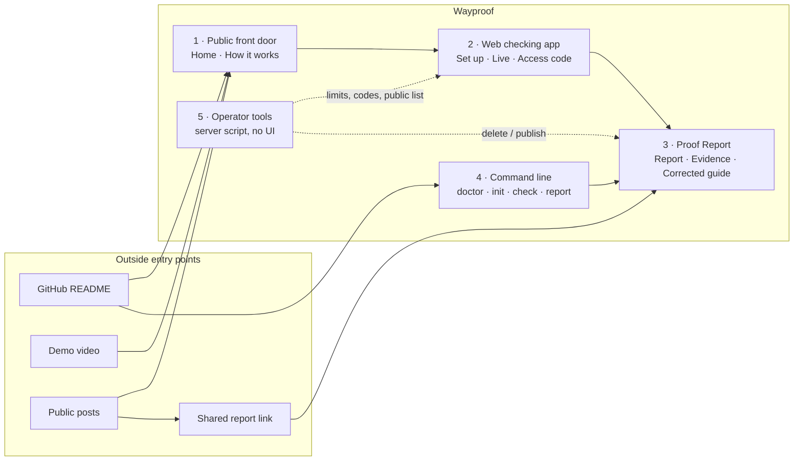
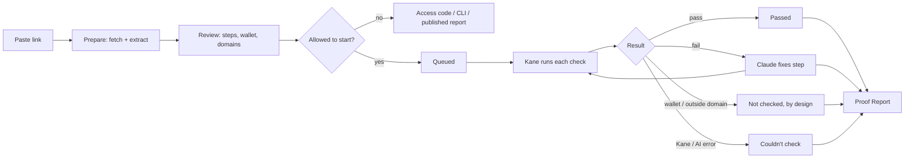

# PRODUCT_SURFACE_MAP.md — Wayproof

> **Status:** Draft for owner review · 16 Nov 2026 · nothing here is implemented yet.
> **Labels:** **CONFIRMED** (= [Rule] hackathon pages, [Kane doc], [Decided] owner) · **ASSUMED** · **NEEDS CONFIRMATION** (`TC-n`, see `docs/README.md`) · **RECOMMENDATION**.
> This file **references** other docs instead of repeating them: screens and flows → `docs/02-UX-USER-FLOWS.md`; requirements and rules → `docs/04-SRS.md`; technical design → `TDD.md`.

---

## 1. Document purpose

Shows Wayproof as a set of connected **surfaces** — the different "places" people meet the product — and how they fit together: who uses each one, how people enter, where access is limited, which screens and states exist, and what is essential for the hackathon. It is the map; the other documents are the detail.

---

## 2. Product overview

Wayproof checks whether a crypto project's **guides, official links and key screens actually work**. Kane CLI follows each step in a real browser; when a step fails, Claude proposes a corrected step and Kane re-runs it to prove the fix. The result is a **Proof Report** in which every verdict links to Kane evidence. — **CONFIRMED [Decided]**

It comes as a **command-line tool and a web app** — **CONFIRMED [Decided]**. It never connects a wallet or signs anything (BR-1) — **RECOMMENDATION, adopted in the SRS**.

---

## 3. Product ecosystem overview

Wayproof is **not one website**. It has five surfaces plus outside entry points:



**In plain English:** people arrive from the README, the video, social posts or a shared report link. The **front door** explains Wayproof and takes a guide link. The **checking app** runs the check live. Everything ends in the **Proof Report**, which is also what the command line produces — so web and CLI users see the same report. The **operator tools** are just a script for you to manage limits and codes; nobody else sees them.

---

## 4. Target users and intentions

Personas are from our conversation, **not user research** — **ASSUMED** (details in `docs/02` §1).

| User | Main intention | Main surfaces | Device (ASSUMED) |
|---|---|---|---|
| P-1 Ada, everyday crypto user | "Can I trust this guide before I bridge / revoke?" | Front door → App → Report | Phone or laptop |
| P-2 Tunde, docs owner | "Which of our steps are broken, and what should they say?" | CLI or App → Report → Corrected guide | Laptop |
| P-3 Mira, front-end dev | "Block a deploy that breaks the screens our guide needs" | CLI gate (Could) | CI |
| P-4 Judge (TestMu AI engineers) **CONFIRMED [Rule]** | "Does it ship, did Kane prove something, did the agent and Kane talk?" | README → published Report → App or CLI → video | Laptop (ASSUMED) |
| Operator (owner) | Keep credits safe, publish good reports | Operator tools | Laptop |
| Someone receiving a shared link | "What did this check find?" | Report only | Phone (ASSUMED) |

---

## 5. Product surface map

```
WAYPROOF
├── 1. PUBLIC FRONT DOOR  (public)                      MVP essential
│   ├── Home — one-line explanation, paste a guide link, recent public reports   S-01
│   └── How it works — the loop, the safety boundary, evidence, links            S-09
│
├── 2. WEB CHECKING APP  (public, limited)              MVP essential
│   ├── Set up check — steps found, wallet steps, allowed domains, links          S-02
│   ├── Access code / limit reached  (only when needed)                           S-07
│   └── Live check — each check running in Kane, fixes, re-runs                   S-03
│
├── 3. PROOF REPORT  (public read-only, by link)        MVP essential
│   ├── Report — score, verdicts, share                                           S-04
│   ├── Check detail — attempts, Kane evidence, judge, fix                        S-05
│   └── Corrected guide — original vs corrected, copy / download                  S-06
│
├── 4. COMMAND LINE  (user's own computer)              MVP essential
│   ├── doctor — setup readiness                                                  T-01
│   ├── init — create wayproof.yml                                                T-02
│   ├── check — live progress → summary → HTML report (= surface 3)               T-03, T-04
│   ├── report <id> — reopen a report                                             —
│   ├── errors                                                                    T-05
│   └── gate (CI)                                                    Optional (F-8 Could)
│
├── 5. OPERATOR TOOLS  (owner only, on the server)      Important
│   └── script: create access codes, set limits, mark report public, delete      — (no UI)
│
└── SHARED: Error page S-08 · global header · verdict legend · report link
```

**Deliberately not included (Out of scope):** accounts / login / registration, wallet connection, onboarding wizard, user dashboard or history, settings, pricing, blog, separate docs portal, admin web dashboard, native mobile app. Reasons in §16.

---

## 6. Detailed surface definitions

### 6.1 Public front door
| | |
|---|---|
| **Purpose** | Explain Wayproof in seconds and start a check — the home page **is** the app's entry, not a separate marketing site |
| **Audience** | Everyone; judges arriving from the README |
| **Responsibilities** | One-line value statement; guide-link input; examples of real published reports (proof it works, and the judges' fallback F-7); safety promise ("never connects a wallet") |
| **Relationships** | → App (S-02) on submit; → Report (published examples); ← README, video, posts |
| **Access** | Public |

### 6.2 Web checking app
| | |
|---|---|
| **Purpose** | Turn a guide link into a running Kane check the user can watch |
| **Audience** | Ada, Tunde, judges |
| **Responsibilities** | Show what Wayproof understood (steps, wallet steps, domains) **before** spending credits; apply limits / codes; stream live progress; allow Stop |
| **Relationships** | ← Front door; → Access code if needed; → Report when done |
| **Access** | Public within limits (BR-9); access code beyond limits (TC-10) |

### 6.3 Proof Report
| | |
|---|---|
| **Purpose** | The product's real output: what Kane proved, what was fixed, with evidence |
| **Audience** | Everyone with the link; judges; docs owners |
| **Responsibilities** | Score and verdicts; evidence for every verdict (BR-8); corrected guide; share link; date of the check (BR-12) |
| **Relationships** | ← App, ← CLI (`report.html`, same layout), ← shared links, ← front door examples |
| **Access** | Anyone with the link (unlisted); listed on Home only if the operator marks it public — RECOMMENDATION (TDD §11) |

### 6.4 Command line
| | |
|---|---|
| **Purpose** | Run checks on your own computer with your own Kane login and Claude key; repeatable; usable in CI |
| **Audience** | Tunde, Mira, judges who prefer to run it themselves |
| **Responsibilities** | Readiness check, config, live terminal progress, exit codes, the same report as the web |
| **Relationships** | ← README; → Proof Report (local HTML) |
| **Access** | Local; requires Kane login and `ANTHROPIC_API_KEY` (checked by `doctor`) |

### 6.5 Operator tools
| | |
|---|---|
| **Purpose** | Protect Kane credits and curate public examples |
| **Audience** | Owner only |
| **Responsibilities** | Create / expire access codes, set limits, mark reports public, delete runs |
| **Access** | Server shell only — RECOMMENDATION (TDD §15); no web admin |

---

## 7. Complete user journeys

### J-1 · Judge (highest priority) — UF-11
| | |
|---|---|
| **Start** | GitHub README |
| **Intention** | Verify the three bars quickly |
| **Path** | README "Try it in 2 minutes" → published Proof Report (S-04) → open a check (S-05) to see Kane evidence and the fix loop → optionally run a live check (S-01→S-02→S-03) or the CLI → video |
| **Branches** | Live app busy or limit reached → S-07 offers the published report and CLI path |
| **Complete when** | Judge has seen a Kane-verified fix with evidence |
| **Failure / recovery** | Web app down → published reports + video + CLI still work (fallback required by the rules [Rule]) |

### J-2 · New visitor checks a guide (Ada) — UF-1, UF-2
| | |
|---|---|
| **Start** | Home (from a post or search) |
| **Path** | Paste link → S-02 review (wallet steps marked "not checked") → Start → S-03 live → S-04 report → S-06 corrected guide |
| **Branches** | Invalid URL (inline), fetch fails, not a guide, limit reached (S-07), domain outside list |
| **Complete when** | She knows which steps work, which need her wallet, and the corrected wording |
| **Failure / recovery** | All error paths in `docs/02` UF-7 |

### J-3 · Someone opens a shared report — UF-4
| | |
|---|---|
| **Start** | Link in a chat / post, usually on a phone (ASSUMED) |
| **Path** | S-04 → S-05 / S-06 → optional "Check another guide" → Home |
| **Complete when** | They understand the verdicts and the date checked |
| **Failure** | Link wrong or deleted → S-08 `ERR-NOT-FOUND` → Home |

### J-4 · Docs owner on the command line (Tunde) — UF-8, UF-9
| | |
|---|---|
| **Start** | README |
| **Path** | Install Kane + log in → install Wayproof → `doctor` → `init` → `check` → `report.html` → copy corrected steps |
| **Branches** | `doctor` ❌ shows the exact fix; Kane errors → `ERR-KANE` |
| **Complete when** | Report with evidence on disk; exit code reflects result |

### J-5 · Returning user
No accounts, so "returning" means **returning via a link**: a bookmarked/shared report, or a live run link (`/run/:id` keeps working while the run continues on the server, FR-5). There is no history list — **RECOMMENDATION** (out of scope).

### Friction found and proposed simplifications (RECOMMENDATION)
1. **Losing a run:** if Ada closes the tab she has no way back. → Show **"Copy link to this run"** at the top of S-03 from the start.
2. **Long waits:** Kane runs take real time and the runner does one at a time (TDD ADR-007). → Show a **Queued — position N** state and what's happening next; this state is missing from `docs/02` and `docs/03`.
3. **S-02 review step:** kept on purpose — it's where the user confirms allowed domains (BR-2 safety) and sees wallet steps before credits are spent.
4. **Judges shouldn't need to wait:** published reports on Home are the fastest path to the evidence.

---

## 8. Authentication and access strategy

**Chosen: Approach C with limits — public application, no accounts.** CONFIRMED [Decided: no accounts]; limits and codes RECOMMENDATION (TC-10).

**Why:** the product's value is a one-off check and a shareable report; accounts add work and friction without helping the core task. The only scarce resource is **Kane credits**, which limits + codes protect.

| Thing | Access |
|---|---|
| Home, How it works | Public |
| Prepare a check (fetch + extract steps) | Public, rate-limited (costs Claude tokens) |
| Start a check | Public within daily limit (BR-9); beyond it → access code |
| Live run page `/run/:id` | Anyone with the link |
| Reports, evidence, corrected guide | Anyone with the link; listed on Home only if marked public |
| Stop a run | Anyone on that run page — **NEEDS CONFIRMATION** (simplest; risk: someone with the link can stop it) |
| Operator actions | Server shell only |
| CLI | User's own Kane login + Claude key; no Wayproof login |

**Wallets — kept clearly separate:** Wayproof itself has **no wallet connection, no wallet sign-in, no transaction signing — ever** (BR-1). The *sites being checked* have wallet steps; those are marked "Not checked — wallet step", and if Kane unexpectedly meets a wallet prompt the run stops (`ERR-BOUNDARY`).

**Access errors and recovery:**
| Situation | User sees | Recovery |
|---|---|---|
| Daily limit reached | S-07: why limits exist | Open a published report of the same guide · enter a code · use the CLI |
| Invalid / expired / used-up code | `ERR-ACCESS` inline on S-07 | Re-enter; or CLI |
| Report not found / deleted | S-08 `ERR-NOT-FOUND` | Go home |
| CLI not logged in to Kane / no Claude key | `doctor` ❌ with exact fix command; `ERR-KANE` / `ERR-CONFIG` | Run the fix command |

There are **no protected routes** in the web app; S-07 is shown only when Start is refused.

---

## 9. Navigation architecture

- **Global header (every web screen):** Wayproof wordmark → Home · "How it works" · "GitHub" (external). No sidebar — the product has too few areas to need one.
- **Mobile:** same three items; no hamburger menu needed (RECOMMENDATION — three items fit at 360 px; verify in design).
- **Contextual navigation:** S-04 → each check (S-05) and "Corrected guide" (S-06); S-05/S-06 → "Back to report". S-03 → "View report" when done.
- **Breadcrumb:** only on S-05 and S-06 ("Report › Step 3"), because they are one level below the report.
- **Front door ↔ app:** the same site; no "Launch app" hand-off.
- **CLI:** `wayproof --help` lists commands; every error prints the next command to run.

---

## 10. Route architecture

Matches `TDD.md` §9 — with one conflict to resolve (below).

| Route | Surface | Purpose | Access | Main content | Related |
|---|---|---|---|---|---|
| `/` | Front door | Explain + paste link | Public | Value line, input, published reports, safety promise | `/check/new`, `/report/:id` |
| `/how-it-works` | Front door | Explain loop, safety, evidence | Public | Diagram, boundary, links to repo/video | `/` |
| `/check/new?url=` | App | Review before starting | Public | Steps, wallet steps, domains, optional links | `/access`, `/run/:id` |
| `/access` | App | Limit reached / enter code | Public | Reason, 3 options, code field | `/run/:id` |
| `/run/:id` | App | Live check | Link | Check rows, states, Stop, copy run link | `/report/:id` |
| `/report/:id` | Report | Proof Report | Link | Score, verdicts, share, date | `/report/:id/check/:checkId`, guide |
| `/report/:id/check/:checkId` | Report | Evidence for one check | Link | Attempt timeline, screenshots, raw output | `/report/:id` |
| `/report/:id/guide` | Report | Corrected guide | Link | Original vs corrected, copy/download | `/report/:id` |
| any unknown / failure | Shared | S-08 error | — | Plain message + next action | `/` |

**Conflict:** `docs/02` uses `/report/:id/guide/:guideId`; `TDD.md` uses `/report/:id/guide`. A web run checks **one** guide; a CLI run may contain several guides (`wayproof.yml`). **RECOMMENDATION:** `/report/:id/guide` for one guide, `/report/:id/guide/:guideId` only when a report has several. **NEEDS CONFIRMATION** before updating both docs.

No redirects for authentication (there is none). `/run/:id` for a finished run → shows "Finished" with **View report** (RECOMMENDATION: not an automatic redirect, so the link never feels broken).

---

## 11. Screen and page inventory

Full detail lives in `docs/02` §4 and `docs/03`. Summary grouped by surface:

| Screen | Surface | Purpose | Primary action | Secondary | Entry | Access | Key states | Responsive note |
|---|---|---|---|---|---|---|---|---|
| S-01 Home | Front door | Start a check | **Check this guide** | Open a published report; How it works | Direct, header | Public | Empty input, invalid URL, loading (preparing), no published reports yet | Input full width on phone; examples stack |
| S-09 How it works | Front door | Build trust | Back to Home | GitHub, video | Header | Public | Static | Diagram must stay readable at 360 px (stacked) |
| S-02 Set up check | App | Confirm before spending credits | **Start check** | Back; edit domains; add links | S-01 | Public | Preparing, fetch error, no steps, outside-domain warning, all steps need wallet (nothing to check) | Two columns → one; Start in sticky bottom bar on phone |
| S-07 Access code | App | Explain limit; unlock | **Use code** | Open published report; run with CLI | Start refused | Public | Invalid / expired code | Single column |
| S-03 Live check | App | Watch progress | **Stop** | Copy run link; View evidence | S-02, S-07, run link | Link | Queued (position), running, per-check states, reconnecting, stopped, finished | Rows become cards; evidence opens full-screen sheet instead of side panel |
| S-04 Proof Report | Report | Understand results | **Share** | Open check; Corrected guide; Download | S-03, link, CLI | Link | Loading, partial (stopped / interrupted / budget), all passed, not found | Score above list on phone |
| S-05 Check detail | Report | See evidence | Back to report | Open Kane test link; download raw | S-04 | Link | Missing evidence (should never happen — BR-8), screenshots loading | Timeline vertical; screenshots full width, zoomable |
| S-06 Corrected guide | Report | Use the fix | **Copy** | Download .md | S-04 | Link | Nothing corrected (all passed) | Side-by-side → Original/Corrected toggle |
| S-08 Error | Shared | Recover | Go home | Try again (if retryable) | Any failure | — | Per ERR code | Single column |
| T-01…T-05 | CLI | Terminal views | — | — | Commands | Local | Colour and no-colour output | Readable at 80 columns (RECOMMENDATION) |

**Gap found:** a "nothing to check — every step needs a wallet" state on S-02 is not in `docs/02` yet. It's plausible for some crypto guides (TC-2).

---

## 12. Core workflows

| Workflow | Where defined | Surfaces |
|---|---|---|
| Check a guide (prepare → review → run → report) | `docs/02` UF-1; `TDD.md` §14.1 | Front door → App → Report |
| Fix loop (Kane fail → Claude fix → Kane re-run → verdict) | `docs/02` UF-2; `docs/04` FR-20…27; `TDD.md` §14.2 | App (live) → Report (evidence) |
| Links check | UF-5; FR-40…43 | App → Report |
| Access code | UF-6 | App |
| CLI first run / check | UF-8, UF-9 | CLI → Report |
| CI gate (Could) | UF-10 | CLI |
| Judge path | UF-11 | All |


*Reading it:* every path ends in a report — even errors and stops — so the user is never left without an answer.

---

## 13. System states and edge cases

| Area | States | User sees / can do |
|---|---|---|
| **Run** | queued · running · finished · stopped (by user) · interrupted (server restart) · failed | Queue position; live rows; partial report with reason for stopped/interrupted |
| **Check verdict** (`docs/03` §5) | waiting · running in Kane · failed → fixing → re-running · Passed · Verified fixed · Needs a human · Not checked — wallet step · Not checked — outside allowed domains · Couldn't check · Not run — budget reached · Stopped safely (wallet prompt met) | Each with words + icon (never colour alone) and View evidence |
| **Live connection** | live · reconnecting · resumed | Banner; nothing lost (events replay, TDD §10) |
| **Access** | within limit · limit reached · code valid · code invalid / expired / used up | S-07 options |
| **Report** | loading · complete · partial · all passed (BR-11: says the guide is correct) · not found | Clear header line stating which |
| **Prepare** | preparing · fetch failed · not a guide · all steps need wallet · domains outside list | Inline messages with Back / Try again |
| **CLI** | doctor all ✅ / some ❌ · running · finished with exit 0/1/2/3 | Fix commands; exit codes FR-55 |

**Not applicable:** login / session expiry, wallet connected / wrong network, transaction pending / confirmed — Wayproof has none of these.

**Naming inconsistency to fix:** verdict names differ slightly between `docs/02` ("Stopped safely", "Not checked — wallet step") and `docs/03` §5 legend ("Wallet step"). Proposal: `UX_WRITING.md` becomes the single source of verdict wording (from the design document list).

---

## 14. Responsive experience architecture

| Surface | Desktop / laptop | Tablet | Phone |
|---|---|---|---|
| Front door | Input + published reports side by side | Stacked | Stacked; input first; examples as list |
| Set up check | Steps left, domains/links right | One column | One column; Start in sticky bottom bar |
| Live check | Table-like rows; evidence side panel | Rows | Cards; evidence as full-screen sheet; Stop always reachable |
| Report | Score beside summary; list of checks | Stacked | Score first, then checks; Share button reachable without scrolling |
| Check detail | Timeline with screenshots beside text | Stacked | Vertical timeline; tap screenshot to zoom |
| Corrected guide | Side-by-side diff | Toggle | Toggle Original / Corrected |
| CLI | Terminal ≥ 80 columns | — | — |

Must stay available on phones: **everything** in surfaces 1–3 (no desktop-only features). Touch targets ≥ 44 px; no horizontal page scroll at 360 px (`docs/03` §6). **Native mobile app: out of scope** — responsive web covers the read-and-share use.

---

## 15. Cross-surface relationships

| Shared item | Across | Note |
|---|---|---|
| Brand, header, verdict legend | Front door, App, Report, CLI HTML report | One design system (design doc list) |
| Proof Report format | Web and CLI | Same builder (TDD C-9) so both look identical |
| Report link | App → Report → anyone | The only "identity" in the product |
| Run data | App ↔ Report | Same run id; `/run/:id` → `/report/:id` |
| Limits / codes | Operator tools → App | Server settings |
| Domains | One site (TC-11) | No separate app domain needed |
| Cross-surface errors | All web surfaces → S-08 | Same ERR messages (`docs/04` §5) |

---

## 16. MVP prioritization

| Item | Class | Why |
|---|---|---|
| Proof Report (S-04, S-05) | **MVP essential** | It *is* the proof judges score (Verified) |
| CLI `doctor`, `check`, report | **MVP essential** | Kane in the loop; works even if hosting fails |
| Fix loop shown live (S-03) | **MVP essential** | Closed loop + "agent and Kane talked" [Rule] |
| Published real reports on Home | **MVP essential** | Judges' fallback [Rule]; fastest proof |
| Front door S-01, Set up S-02 | **MVP essential** | Entry to the web app |
| Corrected guide S-06 | Important | Shows the fix's value |
| Access codes S-07 | Important | Protects credits; can be operator-only if late |
| How it works S-09 | Important | Trust + Craft score |
| Error page S-08 | Important | Required states |
| Links check | Important (Should) | Second check type |
| Queued state + copy run link | Important | Fixes friction found above |
| CLI `init`, `report <id>` | Optional | Nice for P-2 |
| CI gate | Optional (Could) | — |
| Self-verification of Wayproof's own screens by Kane (F-10, FR-65) | **MVP essential** [Decided 17 Nov] | The hackathon challenge: "Build it with any agent, verify it with Kane" |
| Accounts, history, settings, admin UI, pricing, blog, docs portal, native app, wallet anything | **Out of scope** | No user need for a 3-day hackathon; adds risk |

**Trade-off:** the web app is the most visible part but also the riskiest (hosting TC-4). The CLI + published reports alone meet the rules, so they are built first (TDD §23).

---

## 17. Dependencies and technical considerations
- Runner hosting with Chrome + kane-cli (TC-4) decides whether surfaces 2 and live S-03 exist on judging day.
- One Kane run at a time → the queued state is real, not hypothetical.
- Report pages are server-rendered so shared links preview correctly (TDD §9).
- No secrets reach any web surface (TDD §16).

---

## 18. Assumptions and unresolved questions

| ID | Item | Type |
|---|---|---|
| A-1 | Personas and their devices | ASSUMED |
| A-2 | Judges mostly use laptops | ASSUMED |
| A-3 | Three header items fit on a 360 px phone without a menu | ASSUMED — verify in design |
| Q-1 | Corrected-guide route: `/guide` vs `/guide/:guideId` (§10) | NEEDS CONFIRMATION |
| Q-2 | Can anyone with the run link press Stop? | NEEDS CONFIRMATION |
| Q-3 | Are visitor reports unlisted by default (only operator-marked ones on Home)? | NEEDS CONFIRMATION (RECOMMENDATION: yes) |
| TC-2, TC-4, TC-10, TC-11 | Kane's reach before the wallet, hosting, limits, domain (TC-1 guides approved 16 Nov 2026) | NEEDS CONFIRMATION |

---

## 19. Recommended next steps
1. Owner reviews this map and answers Q-1…Q-3.
2. Update `docs/02` (queued state, all-wallet state, route decision) and `docs/03` (states) and `TDD.md` §9 to match.
3. Then the design documents (brand, UX, design system, UX writing, accessibility) — after approval.
4. No screen design or code before approval.

---

## 20. Related documents
`hackathon.md` · `docs/README.md` · `docs/01-PRD.md` · `docs/02-UX-USER-FLOWS.md` · `docs/03-WIREFRAMES-UI-SPEC.md` · `docs/04-SRS.md` · `docs/05-DATA-FLOW.md` · `TDD.md` · `CLAUDE.md` · `DEBUGGING.md`
