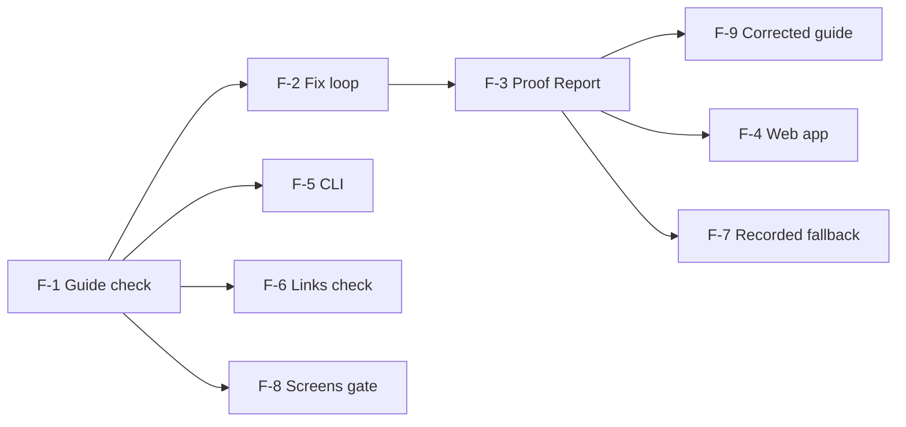
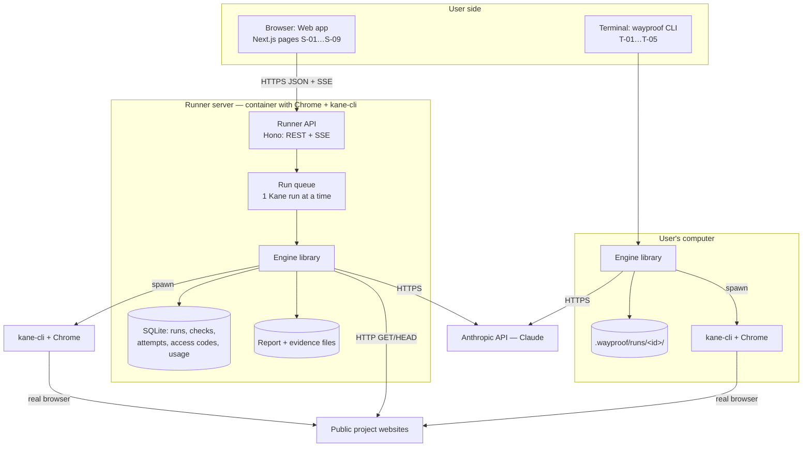
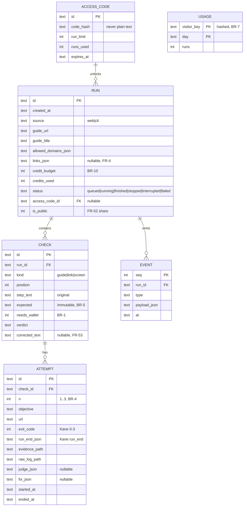
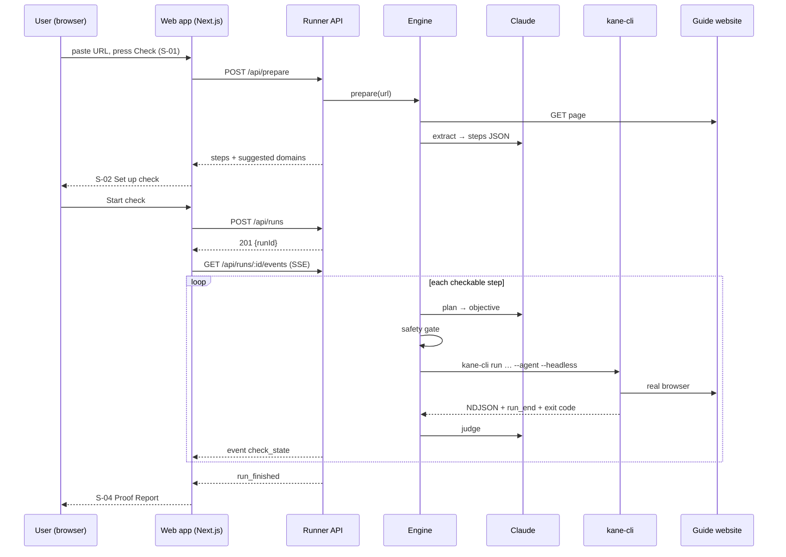
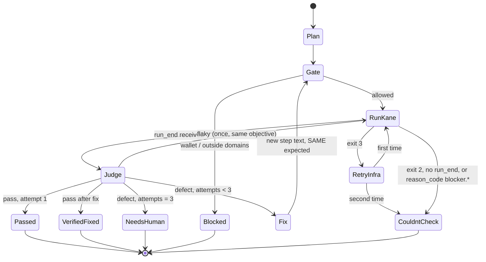
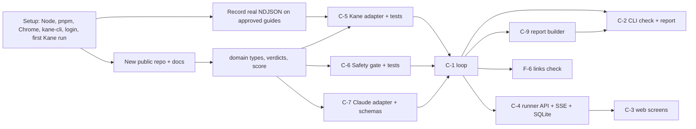

# TDD.md — Technical Design Document: Wayproof

## 1. Document overview and status

| | |
|---|---|
| **Project** | Wayproof — checks whether a crypto project's guides, official links and key screens actually work, using Kane CLI + Claude |
| **Event** | KaneCLI Online Hackathon (TestMu AI). Deadline **Thu 19 Nov 2026, 11:59 PM IST (19:29 Lagos)** |
| **Owner** | softalpha0 (solo; the coding agent acts as architect, tech lead, engineers and security reviewer) |
| **Status** | **Design — approved for nothing yet.** No code exists. Version 1.0, 16 Nov 2026 |
| **Role** | The central technical reference. Replaces `docs/06-ARCHITECTURE.md`. Implementation must follow this file; when implementation changes, this file changes in the same commit |

**Planned vs implemented.** Every component below is **Planned**. Section 23 (dependencies) and the build plan will mark items **Implemented & verified** only after the owner has tested them.

### Certainty labels (used everywhere in this file)
| Label | Meaning | Source |
|---|---|---|
| **CONFIRMED** | Supported by an official source, an owner decision, or a real recorded run | [Rule] hackathon pages · [Kane doc] Kane docs · [Decided] owner · [Observed] seen in a real run on the owner's computer (raw output kept). If [Observed] and [Kane doc] disagree, code follows [Observed] |
| **ASSUMED** | Working assumption, must be validated | Listed in §24 |
| **NEEDS CONFIRMATION** | Unknown; `TC-n` in `docs/README.md` | §24 |
| **RECOMMENDATION** | My proposed technical decision | §22 |

### Related documents (they must agree with this file)
| Protocol name | Wayproof file | Answers |
|---|---|---|
| HACKATHON.md | `hackathon.md` | Rules, judging, submission, tools, setup |
| README.md | `README.md` (to be written in the repo) + `docs/README.md` (doc index, facts, decisions, TC list) | What it is / how to run · single source of facts |
| PRD | `docs/01-PRD.md` | What and why |
| USER_EXPERIENCE.md | `docs/02-UX-USER-FLOWS.md` | Personas, flows `UF-`, screens `S-`/`T-` |
| DESIGN_SYSTEM.md | `docs/03-WIREFRAMES-UI-SPEC.md` | Wireframes, components, tokens |
| Functional spec | `docs/04-SRS.md` | Requirements `FR-`, rules `BR-`, errors `ERR-` |
| Data flow | `docs/05-DATA-FLOW.md` | Flows `DF-`, stores `D-` |
| BUILD_PLAN.md | §23 of this file | Build order and dependencies |
| FEATURE_GUIDE.md | **Not created yet** — create when the first feature is implemented and verified | What has actually been built |
| Debugging | `DEBUGGING.md` | Bug investigation procedure |

---

## 2. Project summary and understanding

**Problem — CONFIRMED [Decided]:** crypto users follow written guides for risky actions (bridging, revoking approvals, using official links). Guides go out of date — renamed buttons, missing steps, links that point elsewhere — and users get stuck or take the wrong path. The owner also experiences AI agents claiming work is done when it isn't.

**Solution — CONFIRMED [Decided]:** Wayproof reads a guide (and optionally official links and key screens), turns each step into a plain-English objective, has **Kane CLI** follow it in a real browser, sends failures to **Claude** for a corrected step, and re-runs Kane to **prove** the correction. Output: a **Proof Report** where every verdict links to Kane evidence.

**Users** — RECOMMENDATION (from conversation, not research): P-1 everyday crypto user, P-2 docs/devrel owner, P-3 front-end developer, P-4 hackathon judge (`docs/02` §1).

**Value / difference:** nothing is reported as correct until Kane ran it; nothing is reported as broken unless Kane observed it (BR-11). Fixes are proven, not suggested.

**Why it fits the hackathon — CONFIRMED [Rule]:** bar 2 "Kane CLI caught or proved something" = every verdict is Kane evidence; bar 3 "your agent and Kane CLI talked to each other" = the fix loop (§14.2); Closed loop = Kane result → Claude fix → Kane re-run.

**Features** (`docs/01` §5): F-1 Guide check (Must) · F-2 Fix loop (Must) · F-3 Proof Report (Must) · F-4 Web app (Must) · F-5 CLI (Must) · F-6 Links check (Should) · F-7 Recorded fallback (Must) · F-8 Screens gate (Could) · F-9 Corrected guide download (Should).

**Feature dependencies:**

**Required for the demo:** F-1, F-2, F-3, F-5, F-7 (and F-4 for the live URL, which is optional per the rules [Rule]).

**Existing technical state — CONFIRMED:** no repository and no code exist yet. Setup steps 1–9 of `hackathon.md` Part 4 were done and verified on 16 Nov 2026: Windows 11 Pro + PowerShell 5.1, Git 2.56.0, Node v26.13.0 (LTS), pnpm 12.18.0, Chrome 157 stable, Kane CLI 0.10.4 logged in, first Kane run passed (§13.1 "Observed"). I have not inspected any code because there is none.

---

## 3. Scope and non-goals

**In scope:** F-1…F-9 above; command line and web app [Decided]; Claude for Wayproof's agents [Decided]; real public guides only [Decided].

**Non-goals (v1):**
- Connecting wallets, signing, sending transactions (BR-1) — RECOMMENDATION.
- User accounts / passwords [Decided: no accounts].
- Mobile app targets — local simulators need macOS Apple Silicon, real devices need a paid plan [Kane doc].
- A self-built demo site with planted mistakes [Decided: real projects only].
- Crawling pages not declared by the user (BR-2).
- Multiple runner servers / horizontal scaling.

---

## 4. Requirements and constraints

Functional requirements: `docs/04-SRS.md` §3 (FR-1…FR-64). Business rules: §2 there (BR-1…BR-12). Non-functional: NFR-1…NFR-9.

**Hard constraints — CONFIRMED:**
| Constraint | Source | Design impact |
|---|---|---|
| Kane CLI required; installed via npm; needs Node 18+ and Chrome | [Rule] [Kane doc] | Node/TypeScript stack; runner host must have Chrome |
| Agent and Kane must talk to each other | [Rule] | Programmatic loop (§14.2) |
| Judges must be able to run it; credentials + fallback for third-party services | [Rule] | Published real reports + video; CLI quick start; web app live |
| New public repo, created ≥ 12 Nov | [Rule] | Fresh repo; docs committed first |
| 10,000 free Kane credits for one month | [Rule] | Budgets (BR-10) and web limits (BR-9) |
| Deadline Thu 19 Nov 19:29 Lagos | [Rule] | Minimal architecture; strict order (§23) |
| Beginner owner, solo, ~3 days | [Decided] | One language, one engine, few moving parts |

---

## 5. Architecture overview

**RECOMMENDATION: a modular monolith — one shared engine library used by two front ends.**

- The **engine** contains all the logic: read the guide, ask Claude, run Kane, judge, fix, build the report.
- The **CLI** runs the engine directly on the user's computer (user's own Kane login and Claude key).
- The **web app** is a website that talks to a small **runner service**; the runner runs the same engine on a server that has Chrome and Kane installed (Wayproof's Kane login and Claude key).

**In plain English:** there is only one "brain" (the engine). The CLI and the website are two different doors into it. The website can't run Kane inside your browser, so it asks the runner server to do it and streams the progress back.

**Alternatives considered:**
| Option | Why not chosen |
|---|---|
| Separate microservices (fetch service, AI service, Kane service) | Too much to build, deploy and debug in 3 days for one beginner; no scaling need |
| CLI only | Owner decided on CLI **and** web app [Decided] |
| Web app only, running Kane in a serverless function | Kane needs a real Chrome and long-running processes; serverless timeouts and missing Chrome make this unreliable — **NEEDS CONFIRMATION** for any specific provider |
| One big autonomous AI agent controlling everything | Hard to test, unpredictable, safety rules would live in prompts instead of code |

---

## 6. Architecture diagram

**Reading the diagram:** the top-left is what the user touches. The website (Browser) only talks to the Runner API; it never talks to Claude or Kane directly, so no secret ever reaches the browser. The runner puts each check in a queue, the engine does the work, saves results in SQLite and files, and streams progress back. The CLI path (bottom) is the same engine on the user's own computer, saving to a local folder.

---

## 7. Technology stack and rationale

Status column: what is installed **on the owner's computer** (checked 16 Nov 2026). **Not installed** = nothing set up yet. Nothing is installed on a runner host yet (TC-4).

| Technology | Purpose / where | Why selected | Alternatives | Limitations | Certainty | Status |
|---|---|---|---|---|---|---|
| **Kane CLI** `@testmuai/kane-cli` | Browser verification; engine (C-5) | Required by the hackathon | — | Needs Chrome; credits | CONFIRMED [Rule][Kane doc]; Windows CONFIRMED [Observed] (TC-13 resolved) | Installed 0.10.4, logged in, first run passed |
| **Google Chrome (stable)** | Used by Kane | Required by Kane | — | Must exist on runner host | CONFIRMED [Kane doc] | Installed 157.0.8103.78 stable, standard path (no `KANE_CLI_CHROME_PATH` needed) |
| **Node.js 22+ LTS** | Runtime for everything | Kane is an npm package needing Node 18+; execa 10 needs Node 22+; Node 20 reached end of life in April 2026; one language for all parts | Python (would split the codebase) | — | RECOMMENDATION; 22+ [Decided 17 Nov 2026] | Installed v26.13.0 (LTS); Corepack not bundled |
| **TypeScript** | All code | Type safety helps a beginner + agent catch mistakes early | JavaScript | Build step | RECOMMENDATION | In project: 7.0.2 (root dev dependency); `pnpm typecheck` |
| **pnpm workspaces** | Monorepo (engine, cli, runner, web) | Share the engine package without publishing it | npm workspaces | Extra tool | RECOMMENDATION | Installed 12.18.0 (via npm); workspace set up 17 Nov with `packages/engine` (cli, runner, web added later) |
| **Anthropic SDK (Claude)** | Extract / plan / judge / fix (C-7) | Owner decision | — | Cost; budget TC-3 | CONFIRMED provider and model `claude-opus-5-5` [Decided]; budget NEEDS CONFIRMATION | SDK not installed; API key in `.env` verified 16 Nov |
| **Zod** | Validate config, Kane NDJSON, Claude JSON, API bodies | One validation tool everywhere | Ajv | — | RECOMMENDATION | In project: 4.6.7 (engine dependency) |
| **Commander** | CLI commands | Small and common | yargs, oclif | — | RECOMMENDATION | — |
| **execa** | Spawn `kane-cli` without a shell | Safe argument arrays, streaming stdout | Node `child_process` | Needs Node 22+ | RECOMMENDATION | In project: 10.2.1 (engine dependency) |
| **Readability (Mozilla) + jsdom** | Extract the main text of a guide page | Removes menus/ads before sending to Claude | Raw HTML to Claude (costly, noisy) | Some pages render content with JavaScript (then the extract may be empty → ERR-NO-STEPS) | RECOMMENDATION | — |
| **Hono** | Runner API + Server-Sent Events | Small, fast, built-in SSE helper | Express, Fastify | — | RECOMMENDATION | — |
| **SQLite** (`better-sqlite3`) | Runner storage for runs, codes, usage | One file, no separate database service | Postgres (more setup) | One server only | RECOMMENDATION (TC-12) | — |
| **Next.js (App Router) + React** | Web pages S-01…S-09 | Pages + shareable report URLs | Vite + React SPA | — | RECOMMENDATION | — |
| **Tailwind CSS** | Styling from tokens in `docs/03` §7 | Fast to apply a token-based design | Plain CSS modules | — | RECOMMENDATION | — |
| **Vitest** | Tests | Fast, TypeScript-friendly | Jest | — | RECOMMENDATION | In project: 5.1.0 (root dev dependency); `pnpm test` |
| **GitHub + GitHub Actions** | Public repo (required), CI | Required public repo; free CI | — | — | CONFIRMED repo [Rule]; CI RECOMMENDATION | Not created |
| **Hosting: web front end** | Next.js site | — | Vercel, Netlify, same container | — | NEEDS CONFIRMATION (TC-11) | — |
| **Hosting: runner** | Container with Chrome + kane-cli + persistent disk | Kane needs Chrome and long runs | Any container host with a persistent disk | Free tiers may sleep or lack disks | NEEDS CONFIRMATION (TC-4) | — |

---

## 8. System components

| ID | Component | What it does | Why it exists | Receives | Returns | Talks to | When it fails |
|---|---|---|---|---|---|---|---|
| C-1 | **Engine orchestrator** | Runs a check from start to verdict; enforces budgets | Single place for the loop and rules | Run config | Run with verdicts | C-5…C-10 | Marks the check with a verdict; never crashes the whole run |
| C-2 | **CLI** | Commands `doctor`, `init`, `check`, `report`, `gate` | Developer/judge interface | Args, `wayproof.yml` | Terminal output, run folder, exit code | C-1 | Prints `ERR-…` (T-05), exit code 2 |
| C-3 | **Web front end** | Screens S-01…S-09 | Non-technical interface | User input | Pages | C-4 (HTTPS) | Error states per `docs/03`; S-08 |
| C-4 | **Runner service** | API, queue, limits, SSE, storage | Lets the web app use the engine on a server | HTTP requests | JSON, SSE events | C-1, C-10 | `{code, message}` JSON errors |
| C-5 | **Kane adapter** | Builds and spawns `kane-cli run`, parses NDJSON, maps exit codes, links evidence | Only module that touches Kane | `CheckSpec` | `KaneResult` | `kane-cli` | `ERR-KANE` / `ERR-KANE-TIMEOUT` |
| C-6 | **Safety gate** | Allowed-domain check; wallet tripwire | Enforces BR-1/BR-2 in code | URL + objective; Kane remarks | allow / block(reason) | C-1, C-5, C-8 | Fails closed (blocks) |
| C-7 | **Claude adapter** | 4 prompts with JSON schemas | Only module that calls Claude | Text + context | Validated JSON | Anthropic API | `ERR-AI` after one retry |
| C-8 | **Fetcher & link probe** | GET/HEAD, redirects, main-text extraction | Read guides and check links | URL | Text / probe result | Websites, C-6 | `ERR-FETCH` |
| C-9 | **Report builder** | Score, HTML/MD/JSON, corrected guide | One report format for CLI and web | Run | Report files | C-10 | Report still built from partial data |
| C-10 | **Store** | CLI: files. Runner: SQLite + files | Persistence and crash safety | Run objects | Run objects | disk | Run marked failed with reason |

**No duplication rule:** only C-5 calls Kane; only C-7 calls Claude; only C-6 decides what may be visited; the web front end contains **no** business logic (it displays what C-4 returns).

---

## 9. Frontend architecture (C-3)

- **Framework:** Next.js App Router (RECOMMENDATION). Routes map 1:1 to screens:

| Route | Screen | Data source |
|---|---|---|
| `/` | S-01 Home | `GET /api/reports?public=true&limit=6` |
| `/check/new?url=` | S-02 Set up check | `POST /api/prepare` |
| `/access` | S-07 Access code | `POST /api/runs` with `accessCode` |
| `/run/[id]` | S-03 Live check | `GET /api/runs/:id/events` (SSE) |
| `/report/[id]` | S-04 Proof Report | `GET /api/reports/:id` (server-rendered so shared links preview) |
| `/report/[id]/check/[checkId]` | S-05 Check detail | same + evidence endpoints |
| `/report/[id]/guide` | S-06 Corrected guide | `GET /api/reports/:id/guide.md` |
| `/how-it-works` | S-09 | static |
| error boundary | S-08 | — |

- **State:** no global store. Form state in components; live run state from one SSE hook (`useRunEvents(id)`) that rebuilds the check list from events; reports fetched per page.
- **Components:** exactly those in `docs/03` §4 (StepRow, StatusBadge, AttemptTimeline, ScoreCard, DiffView…). Verdict styling comes from the legend `docs/03` §5.
- **Config exposed to the browser:** only `NEXT_PUBLIC_RUNNER_URL`. No keys.
- **States per screen:** loading (skeletons), empty (`docs/03` empty-state texts), error (ERR texts from `docs/04` §5), success.

---

## 10. Backend architecture (C-4 runner + C-1 engine)

**Runner request lifecycle:**
1. `POST /api/prepare` → C-8 fetch → C-7 `extract` → returns steps + suggested domains (no Kane, no credits).
2. `POST /api/runs` → validate body (Zod) → check limits (BR-9) → insert run → enqueue → return `{runId}`.
3. **Worker** (single, in-process) takes the next run → C-1 executes checks **one Kane run at a time** → each state change is saved to SQLite **and** published to an in-memory event bus.
4. `GET /api/runs/:id/events` → replays saved events, then streams new ones (so a reconnecting browser catches up).
5. Run finished → C-9 writes report files → event `run_finished` → browser navigates to S-04.

**Engine layering (RECOMMENDATION, clean architecture):** `domain` (types, verdicts, score — no imports) ← `orchestrator` (loop) ← **ports** (interfaces: `KaneRunner`, `Llm`, `Fetcher`, `Store`, `Events`) ← **adapters** (real + fake). The CLI and runner inject the real adapters; tests inject fakes.

**Restart behaviour:** on runner start, any run in status `running` is marked `interrupted`; its finished checks keep verdicts; the user can view a partial report.

---

## 11. Database and data architecture

**CLI:** one folder per run, `run.json` written atomically (temp file → rename) after every attempt (D-1); evidence copied/linked into the folder (D-3).

**Runner — SQLite (RECOMMENDATION for TC-12).** Fields come only from FR/BR requirements:

Indexes: `CHECK(run_id)`, `ATTEMPT(check_id)`, `EVENT(run_id, seq)`, `RUN(is_public, created_at)`.

**Data sources and ownership:** guide text and page content come from public websites (E-2); Kane results from Kane (E-3); AI text from Claude (E-4); inputs from the user (E-1). Wayproof owns only the run records it creates.

**Retention / deletion (RECOMMENDATION):** web runs kept 30 days unless public; operator can delete any run (removes rows and files). CLI data stays on the user's disk. No personal data is stored (BR-7); the visitor key for limits is a hash of IP + day.

---

## 12. API specifications (runner, C-4)

All bodies JSON; errors `{ "code": "ERR-…", "message": "<plain text from docs/04 §5>" }`. No authentication except access codes (§15). CORS allows only the web front-end origin.

| # | Method & path | Request | Success response | Errors | Requirement |
|---|---|---|---|---|---|
| A-1 | `POST /api/prepare` | `{ "guideUrl": "https://…" }` | `200 { "title", "steps":[{n, action, expected, needsWallet, url?}], "suggestedDomains":[…] }` | 400 `ERR-URL-INVALID` · 422 `ERR-NO-STEPS` · 502 `ERR-FETCH` · 502 `ERR-AI` · 429 rate limit | FR-1…FR-3 |
| A-2 | `POST /api/runs` | `{ "guideUrl", "steps":[…], "allowedDomains":[…], "links"?: {…}, "accessCode"?: "…" }` | `201 { "runId" }` | 400 `ERR-URL-INVALID`/`ERR-DOMAIN-INVALID` · 403 `ERR-ACCESS` · 429 limit reached (→ S-07) | FR-4…FR-6, BR-9 |
| A-3 | `GET /api/runs/:id/events` | — | `200 text/event-stream`; events `check_state`, `attempt`, `budget`, `run_finished`, `error` | 404 `ERR-NOT-FOUND` | FR-27 |
| A-4 | `POST /api/runs/:id/stop` | — | `200 { "status":"stopped" }` | 404 · 409 already finished | FR-30 |
| A-5 | `GET /api/reports/:id` | — | `200` Run + checks + attempts + score | 404 `ERR-NOT-FOUND` | FR-50, FR-51 |
| A-6 | `GET /api/reports` | `?public=true&limit=6` | `200 [{id, title, score, createdAt}]` | — | S-01 |
| A-7 | `GET /api/reports/:id/evidence/:checkId/:n` | `?type=screenshot|raw` | file | 404 | BR-8 |
| A-8 | `GET /api/reports/:id/guide.md` | — | `text/markdown` | 404 | FR-53 |
| A-9 | `GET /api/health` | — | `{ runner, chrome, kane, kaneLogin, claudeKey }` booleans | — | NFR-4 |

Request size limit 64 KB; Zod validation on every body; unknown fields rejected.

---

## 13. External services and sponsor integrations

### 13.1 Kane CLI — required sponsor tool — CONFIRMED [Kane doc]
- **Does:** follows a plain-English objective in a real Chrome browser; returns pass/fail with evidence.
- **Why:** the hackathon's required technology and the proof behind every verdict.
- **Connect:** spawn `kane-cli run "<objective>" --url <url> --agent --headless --timeout <s> --max-steps <n>` (no shell). Login done beforehand with `kane-cli login` (CI: `--username/--access-key`); check with `kane-cli whoami`.
- **Send:** objective text, start URL, options. **Receive:** NDJSON progress `{step, status, remark}` and `run_end` (fields: see "Observed" below — the docs' `credits` field does **not** exist; it is `credits_consumed`); exit code 0 passed · 1 failed · 2 error · 3 timeout/cancelled; an `.evidence` pack (location: see "Observed").
- **Credentials:** Kane's own store under `~/.testmuai/kaneai/profiles/…` — Wayproof never reads or prints them.
- **Unavailable:** exit 2 → `ERR-KANE` (Couldn't check, BR-6); timeout → retry once → `ERR-KANE-TIMEOUT`. **[Observed] a bot check (Cloudflare captcha) comes back as exit 1 with `run_end.reason_code: "blocker.captcha"`** — the adapter must treat any `reason_code` starting with `blocker.` as Couldn't check (BR-6), never send it to the judge/fix loop, and never report it as a guide defect (BR-11).
- **Limits:** credits per run reported in `run_end.credits_consumed` [Observed]; the account balance fell by more than that on the first run (TC-14), so budgets must not rely on `credits_consumed` alone; `kane-cli balance` prints the account's available credits [Observed]. Free credits for a month [Rule].
- **Unverified:** what Kane sends to TestMu's cloud (TC-5); field names on **failed / error / timeout** runs (only a passing run has been seen, TC-2); why balance drop ≠ `credits_consumed` (TC-14).

#### Observed on the installed version — CONFIRMED [Observed]
Source: first real run on the owner's Windows computer, 16 Nov 2026, Kane CLI **0.10.4**, `kane-cli run "Go to https://example.com and assert the title contains 'Example'" --agent --headless` → **exit 0**. Then six day-0 runs the same day (owner-approved plan; table "Day-0 runs" below). Cleaned copies of all seven outputs are in `fixtures/kane/` (share links and the Windows username removed); raw output stays outside the repo. Exit 0 and exit 1 shapes are now known; **exit 2 and exit 3 have not been seen yet**.

| Item | Observed | Differs from docs? |
|---|---|---|
| stdout | Pure NDJSON: 12 lines, all valid JSON. Every line has `v` (=1) and `ts` (ISO time) | — |
| stderr | Human text only: skill-update notice, "Running on: Desktop · Chrome", and the evidence path with the `evidence serve` command | New |
| Event types | `stream_start` {cli_version, surface, pid} · `recording_state` {enabled, session_id, persist} · `skill_update_available` · `bifurcation` {flows[], count} · progress lines (no `type` field) · `coverage` {status, reason, pack} · `run_end` | Docs list only progress + `run_end` → **parser must ignore unknown types** |
| Progress lines | `{step, status, remark}`; `step` started at **2**; the `running` remark is generic ("Step 1"), the `done` remark says what happened ("navigate: …", "analyze: …", "assert: …") | Numbering + remark detail new |
| `run_end` fields | `type, status, summary, one_liner, final_state {url, page_title}, reason, duration, bifurcated, total_runs, context, credits_consumed, session_dir, run_dir, result_code, reason_code, per_flow_metadata[], run_id, test_url, coverage, v, ts` | **`credits` → `credits_consumed`**; extra fields |
| Pass values | `status: "passed"`, `reason: "Objective completed"`, `result_code: 100`, `reason_code: "success.complete"`, `duration: 18` (unit not stated; likely seconds) | New |
| Evidence pack | One **file** (~166 KB) at `~/.testmuai/kaneai/sessions/<session_id>/evidence/<id>.evidence`; path given in `coverage.pack` and on stderr. **Nothing** was written to `./.testmuai/` in the working folder | Docs say `.testmuai/evidence/` → **read the path from `coverage.pack`**, don't guess it |
| Paths | Windows paths mix `/` and `\` (e.g. `C:\Users\…/.testmuai/kaneai/sessions\…`) | Normalise before use |
| `test_url` | A share link to TestMu Test Manager (contains a share token) | Treat as shareable-but-not-secret; see TC-5 |
| Timing | ~75 s wall clock, of which ~45 s before the first step (start-up/planning) | Affects run-time estimates (§18) |
| Credits | First run: `credits_consumed: 2.88`, balance −17.22. Day-0 runs: balance fell by `credits_consumed` **+ about 2** on every run (+5.75, +2.09, +2.25, +1.93, +2.03, +1.92) | **TC-14** (partly explained) |
| Failed run (assertion) | exit 1; a progress line with `status: "failed"`; `run_end.status: "failed"`, `reason: "Final verification failed: …"`, `reason_code: "assertion_error.final_verification"`, `result_code: 710`, empty `final_state`, extra `verdict` field; Kane's `summary` also suggests a fix ("Update the test URL…") | Matches docs (exit 1); fields new |
| Blocked run (bot check) | exit **1** (not 2); `run_end.status: "failed"`, `reason: "Hard blocker: captcha"`, `reason_code: "blocker.captcha"`, `result_code: 610`; `summary` quotes the HTTP 403 "Just a moment..." page | **Differs from what we assumed**: a blocker is not exit 2 → map `blocker.*` to Couldn't check |
| `test_url` | Missing from one `run_end` (Arbitrum bridge run) | Treat as optional |
| `--timeout 5` | Did **not** time out: run took 23 s and passed (exit 0) — the limit does not seem to count from process start | Don't rely on `--timeout` alone; Wayproof needs its own process timer. Exit 3 shape still unknown |
| stderr on failures | Extra line "1 status_disagrees advisory(ies) — self-explained by triaged failure record(s)" | Ignore |
| `kane-cli run --help` | Has every flag Wayproof uses (`--url --agent --headless --timeout --max-steps`, default 50). Also `--mode action|testing`, `--analyzer-only`, `--bug-detection`, `--final-validation` — not used in v1 | Extra options exist |
| Skill install | `kane-cli install skill` (the CLI suggests it) besides `npx @testmuai/kane-cli-skill` | New route for setup step 10 |
| npm install | 177 packages; npm blocked the install script of dependency `sharp@0.34.5` (allowScripts), but sharp's prebuilt Windows binary loads fine — not enabled | Watch if image errors appear |

#### Day-0 runs on the approved guides — CONFIRMED [Observed], 16 Nov 2026
All objectives began "Do not connect a wallet or sign anything."; flags `--agent --headless --max-steps 25 --timeout 240`. No wallet prompt or wallet wording appeared in any progress remark.

| Run | Start page | Result | Exit | `reason_code` | `credits_consumed` / balance drop | Time |
|---|---|---|---|---|---|---|
| R-1 Revoke.cash steps 1–4 (look up `vitalik.eth`, Ethereum, sort Newest to Oldest, list shown) | revoke.cash | **Passed** — 8 steps, ended on `revoke.cash/address/vitalik.eth` | 0 | `success.complete` | 23.29 / 29.04 | 196 s |
| R-2 Revoke.cash guide's Etherscan section | etherscan.io | **Blocked by Cloudflare bot check** (HTTP 403) | 1 | `blocker.captcha` | 10.97 / 13.06 | 88 s |
| A-1 Arbitrum step 3 before the wallet | bridge.arbitrum.io → portal.arbitrum.io/bridge/ | **Blocked by Cloudflare bot check** | 1 | `blocker.captcha` | 11.32 / 13.57 | 84 s |
| A-2 Arbitrum step 1 exchanges link | portal.arbitrum.io/projects… | **Blocked by Cloudflare bot check** | 1 | `blocker.captcha` | 11.88 / 13.81 | 95 s |
| F-1 test only: false title assertion | example.com | Failed as intended | 1 | `assertion_error.final_verification` | 16.07 / 18.10 | 71 s |
| F-2 test only: `--timeout 5` | example.com | Passed — did not time out | 0 | `success.complete` | 11.40 / 13.32 | 84 s |

| U-1 Uniswap bridging guide steps 2–5 (replacement for Arbitrum, TC-15): ETH on Ethereum → ETH on Base, 0.01 | app.uniswap.org/swap | Every step done (12 steps, no wallet needed); Buy field showed 0.00999713 ETH with the Base badge — **but the final assertion failed**. Kane's own summary: the result was visible; the check "expected different text or did not interpret the network icon" | 1 | `assertion_error.final_verification` | 32.23 / 34.47 | 198 s |

Total balance drop: **135.36 credits** (11,182.78 → 11,047.42). Blocked runs still cost ~13 credits each.
**U-1 lesson:** exit 1 does not always mean the guide is wrong — here an "analyze" step said the amount was shown, then the "assert" step failed, and Kane flagged "status_disagrees" on stderr. The judge (C-7 `judge`) must read `summary` and the remarks and return `flaky`/wording-problem in such cases, never `defect` (BR-11); the planner should write assertions about visible text/numbers, not icons.
**Consequences:** Revoke.cash's pre-wallet steps are checkable. Every Arbitrum page Kane tried (bridge and portal) and Etherscan are behind a bot check Kane can't pass from this computer — Wayproof must report those as Couldn't check, and must not try to get around the check. Which guide to use instead of / alongside Arbitrum: **TC-15**.
- **Docs:** https://github.com/LambdaTest/kane-cli · https://www.testmuai.com/support/docs/kane-cli-introduction/

### 13.2 Anthropic API (Claude) — CONFIRMED provider [Decided]
- **Does:** reads guides into steps, writes Kane objectives, judges Kane results, proposes corrected steps.
- **Connect:** official Anthropic TypeScript SDK; key in `ANTHROPIC_API_KEY` (server/CLI only).
- **Send:** public page text, steps, Kane summaries/remarks — inside "untrusted content" blocks. Never keys or personal data.
- **Receive:** JSON matching our Zod schemas (§14.2). How to request JSON-only output (prompting vs tool use) follows Anthropic's docs — **NEEDS CONFIRMATION** when implementing.
- **Model:** **Claude Opus 5.5, `claude-opus-5-5`** [Decided 16 Nov 2026]; $4 / $20 per million input / output tokens; 1M-token context, 128K max output (confirmed via the Models API with the owner's key). Read from `ANTHROPIC_MODEL`, never hard-coded.
- **Verified 16 Nov 2026 [Observed]:** `GET /v1/models/claude-opus-5-5` → 200; one test message (effort `low`) → 200, `stop_reason: end_turn`, 20 input / 4 output tokens (≈ $0.0002). Request header used: `anthropic-version: 2026-10-21`.
- **Model rules that shape C-7** (Anthropic API reference, checked 16 Nov 2026 — re-check when implementing): thinking can't be turned off (control depth with `output_config.effort`; default is `medium`, so set it explicitly per prompt); no assistant prefill (400) — get JSON via structured outputs, not prefill; forced `tool_choice` `any`/`tool` returns 400; always check `stop_reason` (incl. `refusal`) before reading content; `temperature`/`top_p`/`top_k` are rejected.
- **Budget / limits:** **NEEDS CONFIRMATION** (TC-3).
- **Unavailable:** retry once on invalid JSON/5xx → `ERR-AI` for that check; run continues.
- **Docs:** https://docs.anthropic.com/

### 13.3 Public project websites (E-2)
Only the guides the owner approves (TC-1). Fetched with plain HTTP (GET/HEAD) and visited by Kane. Some sites may block automated visits → `ERR-FETCH`/`ERR-KANE`, reported honestly.

### 13.4 GitHub (optional, CLI only)
Opening a PR with the corrected guide (FR-53 extension) is **Could**; uses `GITHUB_TOKEN`; never pushes to a default branch.

---

## 14. Main system workflows and sequence diagrams

### 14.1 Web: check a guide (UF-1)

**User sees:** S-02 within the fetch + extract time, then live rows on S-03, then S-04. **Failure:** see §17.

### 14.2 The fix loop (FR-20…FR-26) — the heart of the system

**Claude prompt contracts (C-7):**
| Prompt | Input | Output schema |
|---|---|---|
| `extract` | Guide main text | `{title, steps:[{n:int, action:str, expected:str, needsWallet:bool, url?:str}]}` |
| `plan` | ≤ 3 consecutive steps, allowed domains | `{objective:str, url:str, expected:str}` (objective must include "Do not connect a wallet or sign anything.") |
| `judge` | expected, `run_end.summary`, `final_state`, failing remark | `{outcome:"pass"|"defect"|"flaky"|"blocked", reason:str}` — may not turn a Kane failure into pass (BR-3) |
| `fix` | step text, judge reason, Kane remarks | `{newStepText:str (≤ 3 sentences), rationale:str}` — `expected` copied, never edited (BR-5) |

### 14.3 CLI check (UF-9)
`wayproof check` → load + validate `wayproof.yml` → for each guide: fetch → extract → loop (§14.2) → print T-03 lines → write `run.json` after each attempt → report files → T-04 summary → exit code (FR-55: 0/1/2/3).

### 14.4 Links check (F-6, Should)
For each provided link: HEAD/GET probe (status, redirects, final domain vs allowed list) → if allowed, Kane objective "Open <link> and confirm the page names <project>" → judge → if mismatch and another provided source shows an alternative, fix suggestion → Kane re-check; else Needs a human.

---

## 15. Authentication and authorization

- **User accounts:** **Not applicable** — none by design [Decided].
- **Web permissions:** anonymous visitors within limits (BR-9); **access codes** for higher limits — stored as SHA-256 hashes with limit and expiry; compared in constant time.
- **Operator actions** (create codes, delete runs, mark public): a CLI script run on the server (`pnpm runner:admin`) — no admin web UI in v1 (RECOMMENDATION).
- **Reports:** readable by anyone with the link; contain no personal data (BR-7).
- **CLI:** no Wayproof auth; uses the user's own Kane login and Claude key.
- **Kane / Claude credentials on the runner:** Wayproof's own, stored as host secrets.

---

## 16. Security and privacy

| Area | Design |
|---|---|
| Wallets | BR-1: wallet steps never run; objective tripwire (connect/sign/approve/confirm transaction words); Kane remark tripwire stops the run |
| Browsing scope | BR-2: every URL (fetcher and Kane) checked against allowed domains; redirects to other domains reported, not followed by Kane |
| Command injection | `execa` with argument array, no shell |
| Prompt injection | Untrusted-content blocks; strict schemas; safety gate re-checks every AI output |
| Test weakening | `expected` immutable; checked in code |
| Secrets | `.env` (gitignored) locally; host secrets on the runner. **Never** in frontend code, logs, reports, prompts or GitHub. Only `NEXT_PUBLIC_RUNNER_URL` is public |
| Input validation | Zod on every request, config and model output; URL length/scheme rules (`docs/04` §4) |
| Rate limiting | Per-visitor daily limit + per-run credit budget; `POST /api/prepare` limited too (it costs Claude tokens) |
| Transport | HTTPS for web ↔ runner (host-provided TLS) |
| Error disclosure | Users see plain `ERR-` messages; stack traces only in server logs |
| Logging | No request bodies with codes; no keys; visitor key hashed |
| Third-party risk | Kane/Claude outages → "Couldn't check"/`ERR-AI`, never false verdicts; Kane cloud data handling TC-5 |
| File uploads | **Not applicable** — Wayproof accepts URLs, not files |
| Smart contracts | **Not applicable** — no on-chain code |

**Must be done before the demo:** BR-1 and BR-2 implemented **with tests**; keys only in env/secrets; CORS locked to the web origin; rate limits on A-1 and A-2.

---

## 17. Error handling and reliability

| Situation | Technical handling | User sees |
|---|---|---|
| Invalid input | 400 + Zod issues logged | `ERR-URL-INVALID` / `ERR-DOMAIN-INVALID` inline |
| Missing steps | 422 | `ERR-NO-STEPS` |
| Guide site down / blocks | 502, logged status | `ERR-FETCH`, Try again |
| Claude invalid JSON / 5xx | retry once with validation error → mark check | `ERR-AI` on that check |
| Kane exit 2 | no retry; mark check | `ERR-KANE` "Couldn't check" |
| Kane exit 3 | retry once with timeout × 1.5 | `ERR-KANE-TIMEOUT` |
| Wallet/domain boundary | block before Kane | `ERR-BOUNDARY` / "outside allowed domains" |
| Budget reached | stop scheduling | `ERR-BUDGET` on remaining checks |
| Limit reached / bad code | 429 / 403 | S-07 / `ERR-ACCESS` |
| Duplicate submission (double click) | Start button disabled after click; server ignores identical `POST /api/runs` from the same visitor within 10 s (returns the first `runId`) | Goes to the same run |
| Browser disconnect | Run continues; SSE replays events on reconnect | "Reconnecting…" banner |
| Runner restart mid-run | Running → `interrupted`; partial report | Partial report |
| Database write failure | Run marked `failed` with reason; files kept | S-08 error |
| Unknown server error | 500 with generic message; full error in logs | S-08 |

Every screen has loading, empty, success and error states (`docs/03`).

---

## 18. Performance considerations

- **The bottleneck is Kane runs** (real browser sessions). One at a time on the runner (RECOMMENDATION) — predictable on a small server; queue shows position.
- Group up to 3 consecutive steps per Kane objective to cut runs and credits; split on failure to locate the failing step.
- Cache fetched guide pages per run; skip re-running passed steps only via Kane's `testmd` cache if adopted later (`[Kane doc]` feature, not in v1).
- SSE instead of polling for live progress.
- Reports server-rendered once and cached as files.
- **Not over-engineered:** no Redis, no multiple workers, no CDN for evidence in v1. Later: more workers, object storage for evidence, Postgres.

---

## 19. Deployment and infrastructure

| Environment | What runs | Config |
|---|---|---|
| **Local development** | CLI + engine; optional runner + web locally | `.env`: `ANTHROPIC_API_KEY`, `ANTHROPIC_MODEL=claude-opus-5-5`; Kane logged in locally |
| **Demo / staging** | Same as production, used to publish fallback reports | Separate access codes |
| **Production (judging)** | Web front end (TC-11) + runner container with Chrome, kane-cli, persistent disk for SQLite + files (TC-4) | Host secrets: `ANTHROPIC_API_KEY`, `ANTHROPIC_MODEL`, Kane login (`LT_USERNAME`, `LT_ACCESS_KEY` for `kane-cli login` [Kane doc]), `RUNNER_PUBLIC_ORIGIN`, `WEB_ORIGIN`, `CREDIT_BUDGET_PER_RUN`, `VISITOR_DAILY_RUNS`; web: `NEXT_PUBLIC_RUNNER_URL` |

**Build:** `pnpm install` → `pnpm build` (engine, cli, runner, web) → `pnpm test`.
**Runner image:** Node 22 or newer (LTS) + Chrome stable + `npm i -g @testmuai/kane-cli` + app; on start: `kane-cli login --username … --access-key …` then `wayproof doctor`-style health check (A-9). Kane's docs include Docker/CI recipes [Kane doc] — follow them rather than inventing install steps.
**Deploy:** push to `main` → CI tests → host deploys (exact mechanism depends on TC-4/TC-11).
**Rollback:** redeploy the previous container image / previous web deployment; SQLite file backed up before each deploy (copy).
**Never** put real credentials in docs or the repo; `.env.example` lists names only.

---

## 20. Testing strategy

| Level | What | Tools |
|---|---|---|
| Unit | Loop state machine; verdicts; score (FR-51); domain gate (BR-2); wallet tripwire (BR-1); `expected` immutability (BR-5); NDJSON parser (bad lines, missing `run_end`); exit-code mapping; config schema | Vitest |
| Contract | Kane adapter vs **real NDJSON recorded on day 0**; Claude schemas vs recorded real responses | Vitest + fixtures |
| Integration | Engine end to end with fake Kane + fake Claude; runner API with in-memory SQLite (A-1…A-9) | Vitest |
| End to end | Real Kane + real Claude on approved guides (TC-1) → the published reports | Manual + script |
| User journey | UF-1, UF-9 walked by the owner | Owner |
| UI | Responsive at 360/768/1280 px; keyboard; contrast (NFR-5, NFR-6) | Manual + browser tools |
| Security | Tripwire and domain tests; secret scan before submit; CORS check | Vitest + manual |
| Performance | One full guide check duration and credits recorded in the report | Report metrics |

**Requirement → test map (minimum):** FR-1 URL validation unit · FR-2 extract schema + `ERR-NO-STEPS` · FR-21 adapter contract · FR-22 judge cannot pass a Kane failure · FR-24/BR-5 fix keeps `expected` · FR-26/BR-1 tripwire · BR-2 gate · FR-27 SSE replay integration · FR-51 score unit · FR-55 exit codes.

**A feature is accepted only when:** its tests pass (real output shown), the owner has tested it by hand, and the owner approves. Then commit and push. Bugs follow `DEBUGGING.md`.

---

## 21. Technical risks and limitations

| Risk | Impact | Mitigation |
|---|---|---|
| ~~Kane doesn't run on Windows (TC-13)~~ | Resolved 16 Nov: Kane 0.10.4 ran a headless Chrome test on Windows [Observed] | — |
| Kane output differs from its docs (seen: `credits_consumed`, evidence location, extra event types) | Parser/budget bugs | Build the adapter against recorded real output; ignore unknown event types; read evidence path from `coverage.pack` |
| Balance drops more than `credits_consumed` (TC-14) | Budgets undercount spend | Day-0: drop ≈ `credits_consumed` + ~2 per run; budget with that margin until resolved |
| Real guides need a wallet before most steps (TC-2) | Few checkable steps | Choose guides with pre-wallet steps (Revoke.cash allows address lookup — **confirmed working**); report wallet steps honestly |
| **Sites behind bot checks** (seen: Etherscan, every Arbitrum bridge/portal page tried) | Those steps can't be checked; a blocked run still costs ~13 credits | Map `blocker.*` to Couldn't check (never a defect); never try to bypass a bot check; pick guides whose pages Kane can open (TC-15) |
| Kane `--timeout` not counting from start (day-0 F-2) | A stuck run could run long | Wayproof enforces its own wall-clock limit on the `kane-cli` process |
| Real guides may have no defects | Fewer "caught" moments | "Proved" also counts [Rule wording]; check several guides; never fabricate (BR-11) |
| Sites block automated browsers | Couldn't check | Reported as such; pick other guides |
| Credit burn | Runs stop | Budgets, limits, grouping |
| Hosting with Chrome + persistent disk (TC-4) | Web app not live | CLI + published reports still meet the rules; web app is the first cut if late |
| Kane output format differs on installed version | Parser breaks | Record real output on day 0; tolerant parser |
| Time (≈ 3 days, beginner) | Unfinished features | Strict order §23; cut list |

---

## 22. Technical decisions and trade-offs

| # | Decision | Why | Alternatives | Trade-off |
|---|---|---|---|---|
| ADR-001 | One engine library, two front ends | CLI + web decided; no duplicate logic | Two separate apps | Engine must stay UI-agnostic |
| ADR-002 | Drive Kane via `kane-cli run --agent` NDJSON + exit codes | Kane's documented machine interface; no MCP documented | Kane skill only; UI scraping | Must handle process lifecycle and format drift |
| ADR-003 | SQLite + files on the runner; files for CLI | Simplest durable storage for one server | Postgres | One server only |
| ADR-004 | Four narrow Claude prompts + deterministic loop | Testable, predictable, safety in code | One autonomous agent | Less "magic", more control |
| ADR-005 | Stop at the wallet boundary | Safety, no funds, runnable by anyone | Wallet automation | Post-wallet steps unchecked (labelled) |
| ADR-006 | Real projects only; published reports as fallback | Owner decision; honest evidence | Demo site with planted bugs | Findings depend on real guides |
| ADR-007 | One Kane run at a time on the runner | Small server, predictable credits | Parallel workers | Slower for many users |
| ADR-008 | SSE for live progress | One-way updates, simple, reconnect-friendly | WebSockets, polling | Server → browser only (enough here) |
| ADR-009 | No user accounts; access codes | Owner decision; less to build | Auth provider | Coarse permissions |

---

## 23. Implementation dependencies and build plan

| Day (Lagos) | Build | Gate (owner tests & approves) | Status |
|---|---|---|---|
| Mon 16 | Setup (`hackathon.md` Part 4); approve guides (TC-1); record real Kane output (TC-2); repo + docs; domain + Kane adapter | Real `run_end` saved; adapter test passes on it | Planned |
| Tue 17 | Claude adapter, safety gate, loop, report builder, CLI `doctor`/`check` | `wayproof check` on a real guide → report with evidence | Planned |
| Wed 18 | Runner API + SQLite + SSE; web S-01…S-06 (+S-07, S-09 basic); deploy (TC-4/TC-11); publish reports; links check if time. **Feature freeze 20:00** | Live web check end to end | Planned |
| Thu 19 | README, `FEATURE_GUIDE.md`, video (~3–5 min), 2 public posts, submit by **15:00** | Submission confirmed | Planned |

**Cut order if late:** F-8 screens gate → links Kane proofs (keep probe) → access codes (operator-only runs) → web polish. CLI + published reports alone still satisfy the rules.

---

## 24. Open questions and items needing confirmation

| ID | Item | Affects |
|---|---|---|
| ~~TC-1~~ | Real guides **approved 16 Nov 2026** (Revoke.cash, Arbitrum; Across backup — its guide URL now returns 404). Arbitrum replaced by Uniswap bridging the same day (TC-15) | Demo, evidence |
| TC-2 | Mostly answered 16 Nov (§13.1 day-0): Revoke.cash pre-wallet steps work; Etherscan and Arbitrum pages blocked by bot checks; pass, assertion-fail and blocker shapes recorded. **Still open:** exit 2 and exit 3 output shapes, and what `--timeout` actually limits | Adapter, scope |
| TC-3 | Claude ~~model~~ (decided: `claude-opus-5-5`, 16 Nov) and **budget** (open) | C-7, cost |
| TC-4 | Runner host (Chrome + kane-cli + persistent disk) | Deployment |
| TC-5 | What Kane sends to TestMu's cloud | Privacy text |
| TC-10 | Web limits and access-code policy | BR-9, BR-10 |
| TC-11 | Web domain/host | Live URL |
| TC-12 | Storage choice (SQLite recommended) | §11 |
| ~~TC-13~~ | Kane CLI on Windows — **resolved 16 Nov 2026**: works (0.10.4, headless Chrome run passed) [Observed] | Local CLI |
| TC-14 | Account balance falls by more than `run_end.credits_consumed`: +14.3 on the first run, then **+~2 on each of 6 day-0 runs** — what is the extra (a per-run fee?) | Budgets BR-9/BR-10, `ERR-BUDGET` |
| ~~TC-15~~ | Arbitrum's pages show Kane a Cloudflare bot check. **Decided 16 Nov 2026:** replaced by Uniswap "How to bridge tokens using the Uniswap web app" (its pre-wallet steps run in Kane — U-1); Arbitrum's blocked result kept as an honest Couldn't-check example | Demo, success metric "≥ 2 real guides" |
| ~~ASSUMED-1~~ | Owner's computer is Windows with PowerShell — **confirmed 16 Nov 2026**: Windows 11 Pro 64-bit, Windows PowerShell 5.1 | Setup commands |
| ASSUMED-2 | Grouping ≤ 3 steps per Kane run keeps failures locatable | Credits vs precision |
| ASSUMED-3 | Readability extracts main text from the approved guide pages | `ERR-NO-STEPS` risk |
| Slack | Winners date, workshops/recordings, team rules, bar-3 automation, video limit (TC-6…TC-9) | Planning |

---

## 25. References to official documentation

- KaneCLI Online Hackathon: https://www.kaneclihack.sh/ · setup: https://www.kaneclihack.sh/setup
- Kane CLI: https://github.com/LambdaTest/kane-cli · https://www.testmuai.com/support/docs/kane-cli-introduction/ · cookbook: https://www.testmuai.com/kane-cli-cookbook/
- Anthropic (Claude): https://docs.anthropic.com/
- Node.js https://nodejs.org/ · pnpm https://pnpm.io/ · TypeScript https://www.typescriptlang.org/docs/ · Zod https://zod.dev/ · Hono https://hono.dev/ · Next.js https://nextjs.org/docs · Vitest https://vitest.dev/ · Commander https://github.com/tj/commander.js · execa https://github.com/sindresorhus/execa · Mozilla Readability https://github.com/mozilla/readability · better-sqlite3 https://github.com/WiseLibs/better-sqlite3
- Approved guides (TC-1, TC-15): https://revoke.cash/learn/approvals/how-to-revoke-token-approvals · https://support.uniswap.org/hc/en-us/articles/31092864580877-How-to-bridge-tokens-using-the-Uniswap-web-app · (replaced) https://docs.arbitrum.io/getting-started-users · (backup, 404) https://docs.across.to/user-docs/how-to-use-across/bridging

---

## Consistency check against the other documents (Phase 17)

| Check | Result |
|---|---|
| Every user flow UF-1…UF-11 supported? | Yes: UF-1/2/3/4/6/7 via §9, §12, §14; UF-5 via §14.4; UF-8/9/10 via C-2; UF-11 via published reports (§23) |
| Every screen S-01…S-09, T-01…T-05 has a data source? | Yes (§9 route table; C-2 for T-views) |
| Every FR has a component? | Yes (§8, §12, §20 map) |
| Data flows DF-1…DF-23 covered? | Yes; stores D-1…D-5 map to §11 |
| Sponsor integration correct? | Kane per its docs; no undocumented features used |
| Hackathon compliance? | Public new repo, Kane in the loop, fallback, video, posts — all planned |
| Conflicts found | (1) `docs/06-ARCHITECTURE.md` duplicated this content → **replaced by this file** (06 now points here). (2) `docs/README.md` defined `C-`/`ADR-` in 06 → updated to point to TDD.md. (3) New open item TC-13 (Windows) added. |
