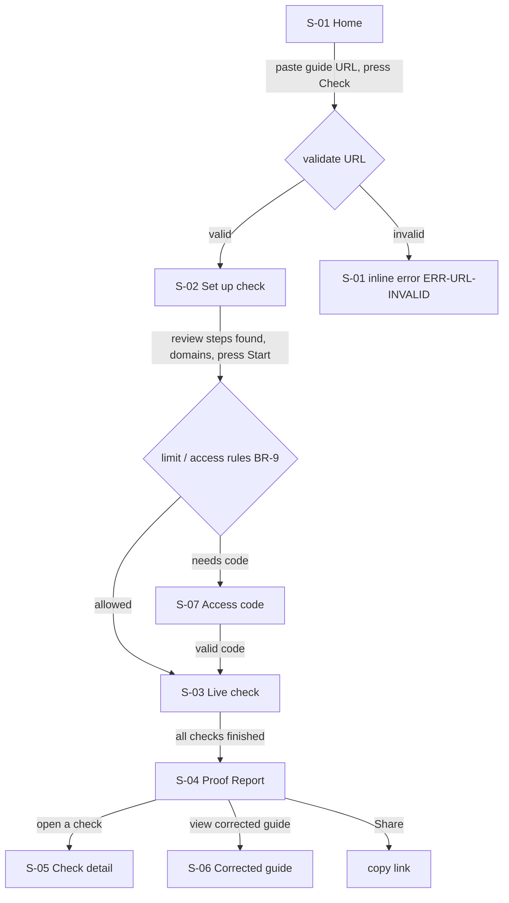

# 02 · UX Design Document — User flows

> Part of the [Wayproof documentation set](README.md). Builds on [01-PRD](01-PRD.md). Screens are designed in [03-WIREFRAMES-UI-SPEC](03-WIREFRAMES-UI-SPEC.md); behaviour is specified in [04-SRS](04-SRS.md).
> Labels: **[Rule]** · **[Kane doc]** · **[Decided]** · **[Proposed]** · **[TC-n]**. Personas below are **[Proposed]** from conversation, not from user research.

---

## 1. Personas

### P-1 · "Ada", everyday crypto user
- Follows project guides to bridge, revoke approvals and find official links. Not a developer.
- **Pain:** guides that are out of date; not sure a link or button is the real one.
- **Goal:** know, before acting, whether a guide's steps actually work and which steps need her wallet.
- **Uses:** web app on phone or laptop.

### P-2 · "Tunde", docs/devrel owner at a crypto project
- Owns the project's guides and official links.
- **Pain:** UI changes break guides; users complain in Discord.
- **Goal:** find broken steps and get corrected wording with proof, before users hit them.
- **Uses:** web app to share reports; CLI to run regularly.

### P-3 · "Mira", front-end developer
- Ships the project's dApp front-end.
- **Goal:** stop a deploy if the key screens a guide depends on are broken.
- **Uses:** CLI in CI (F-8, Could).

### P-4 · Judge (TestMu AI engineer) **[Rule: scored by three TestMu AI engineers]**
- **Goal:** confirm the three bars and score Ships, Verified, Closed loop, Craft in minutes.
- **Uses:** README → web app or CLI → Proof Report → video.

---

## 2. Journeys (high level)

| Persona | Trigger | Journey | Outcome |
|---|---|---|---|
| P-1 | About to bridge using a guide | Opens Wayproof → pastes guide link → watches checks → reads report | Knows which steps work and where her wallet is needed |
| P-2 | Weekly docs review / UI release | Runs `wayproof check` → opens report → copies corrected steps | Updated guide with proof |
| P-3 | Pull request with UI changes | CI runs `wayproof gate` | Deploy blocked or allowed with evidence |
| P-4 | Judging | README → try web app or CLI → open report → watch video | Scores the entry |

---

## 3. Navigation structure

### Web app
```
/                      S-01 Home (paste link)
├─ /check/new          S-02 Set up check
│   └─ /access         S-07 Access code / limit reached (only if needed)
├─ /run/:id            S-03 Live check
├─ /report/:id         S-04 Proof Report
│   ├─ /report/:id/check/:checkId   S-05 Check detail (evidence)
│   └─ /report/:id/guide/:guideId   S-06 Corrected guide
├─ /how-it-works       S-09 How it works
└─ (any failure)       S-08 Error page
```
Global header on every screen: logo (→ S-01), "How it works" (→ S-09), "GitHub" (external). No accounts, no login. **[Decided: no Wayproof accounts — see 01-PRD out of scope]**

### CLI
```
wayproof doctor     → T-01
wayproof init       → T-02
wayproof check      → T-03 (live) → T-04 (summary) → opens S-04 equivalent (HTML report file)
wayproof report <id> [--open]
wayproof gate --url <preview>   (Could, F-8)
Any failure         → T-05 error output
```

---

## 4. Screen inventory

| ID | Screen / view | Interface | Purpose | Reached from | Features |
|---|---|---|---|---|---|
| S-01 | Home | Web | Explain Wayproof in one line; paste a guide link; list of recent public reports | Direct, header logo | F-4 |
| S-02 | Set up check | Web | Confirm detected guide, allowed domains, optional official links; start | S-01 | F-1, F-6 |
| S-03 | Live check | Web | Watch each step and link being checked, attempts and fixes in real time | S-02 | F-1, F-2, F-6 |
| S-04 | Proof Report | Web + CLI (HTML) | Score, summary, every check with verdict, share | S-03 on finish, shared link, CLI | F-3 |
| S-05 | Check detail | Web + CLI (HTML) | One check's attempts: Kane said → judge → fix → re-run, screenshots | S-04 | F-2, F-3 |
| S-06 | Corrected guide | Web + CLI (HTML) | Original vs corrected steps; copy/download Markdown | S-04 | F-9 |
| S-07 | Access code / limit | Web | Explain run limits; enter access code | S-02 when limit applies (TC-10) | F-4 |
| S-08 | Error page | Web | Plain-English error with next action | Any failure | F-4 |
| S-09 | How it works | Web | Three checks, the loop, safety boundary, evidence, links to repo and video | Header | F-4 |
| T-01 | `doctor` output | CLI | Check Node, Chrome, kane-cli, Kane login, Claude key | — | F-5 |
| T-02 | `init` output | CLI | Create `wayproof.yml` with prompts | — | F-5 |
| T-03 | `check` live output | CLI | Progress per check and attempt | — | F-1, F-2, F-6 |
| T-04 | `check` summary | CLI | Verdict table, score, report path, exit code | T-03 | F-3 |
| T-05 | CLI error output | CLI | Error code, plain message, fix hint | Any | F-5 |

---

## 5. User flows

Notation: `[Screen]` · `(action)` · `{system}` · `◇ decision`.

### UF-1 · Web: check a guide (happy path) — P-1, P-2, P-4



Step by step:
1. **S-01** — user pastes a guide URL and presses **Check this guide**. ◇ URL valid and `https`? No → inline error `ERR-URL-INVALID`, stay on S-01.
2. **S-02** — `{system fetches the page, extracts the steps (Claude), lists the domains found}`. Shows: guide title, numbered steps found, which steps need a wallet (marked "Not checked — wallet step"), allowed domains, optional "Also check official links". Buttons: **Start check**, **Back**.
   - Fetch fails → `ERR-FETCH` on S-02 with **Try again** / **Back**.
   - No steps found → `ERR-NO-STEPS` with **Back**.
3. ◇ Run allowed (BR-9/BR-10, TC-10)? No → **S-07**.
4. **S-03** — live list of checks. Each row: step text · status (Waiting / Running in Kane / Passed / Failed → Fixing / Re-running / Verified fixed / Needs a human / Not checked — wallet / Couldn't check). User can **Stop**.
5. When all checks end → automatic move to **S-04** (and a "View report" button in case of delay).
6. **S-04** → user opens a check (**S-05**), the corrected guide (**S-06**), or **Share** (copies the report link).

**Back paths:** S-02 → S-01 (Back). S-03 → Stop asks to confirm, then goes to a partial S-04 (“Stopped by you”). S-05/S-06 → S-04. Header logo → S-01 from anywhere.

### UF-2 · The fix loop (what the user sees while it happens)
For each check on **S-03** (behaviour in [04-SRS FR-20…FR-27](04-SRS.md)):
1. **Running in Kane** (attempt 1).
2. ◇ Kane result:
   - Passed → **Passed ✅** (“Kane followed this step”).
   - Failed → **Failed** with Kane's plain reason → **Fixing** (“Claude is proposing a corrected step”) → shows the proposed wording → **Re-running** (attempt 2).
   - Re-run passed → **Verified fixed 🔧** (shows old → new step).
   - Still failing after the last allowed attempt → **Needs a human ❌** (shows what was tried).
   - Kane/infrastructure error → **Couldn't check ⚠️** (`ERR-KANE`), not counted as a guide defect.
   - Stopped by the safety boundary → **Stopped safely 🛡️** (`ERR-BOUNDARY`).
3. Every state has a **View evidence** link (opens S-05 after the run, or a side panel during the run).

### UF-3 · View evidence for a step — P-4, P-2
S-04 → choose a check → **S-05**: attempt timeline (attempt 1: Kane steps + screenshot + Kane's summary → judge reason → Claude's fix → attempt 2 …), Kane `test_url` link if provided **[Kane doc: run_end.test_url]**, raw Kane output download. Back → S-04.

### UF-4 · Share a report — P-1, P-2
S-04 → **Share** → link copied (toast “Link copied”). Anyone with the link opens S-04 read-only. Reports contain only public page content, Kane evidence and Claude text — no personal data (BR-7).

### UF-5 · Links check (Should, F-6)
On S-02 user ticks **Also check official links** and enters or confirms: website, docs, X, GitHub, audit page, contract explorer link. S-03 shows a **Links** section: each link → Reachable / Redirects to <domain> / Domain not in the allowed list / Kane proof passed / failed. Report section on S-04. Fix behaviour: Claude suggests the correct link only when another official source shows it; Kane re-checks the suggestion (04-SRS FR-40…FR-43).

### UF-6 · Access code / limit reached — P-1
S-02 → Start → ◇ limit reached or project not in the open list (TC-10) → **S-07**: explains Kane credits are limited, offers (a) open a public report of the same guide if one exists, (b) enter an access code, (c) run it yourself with the CLI (link to README). Valid code → S-03. Invalid → `ERR-ACCESS` inline.

### UF-7 · Errors and alternative flows (web)

| Where | What happens | User sees | Next action |
|---|---|---|---|
| S-01 | URL empty/invalid/not https | `ERR-URL-INVALID` inline | Fix the URL |
| S-02 | Page can't be fetched (status, timeout) | `ERR-FETCH` | Try again / Back |
| S-02 | Page is not a step-by-step guide | `ERR-NO-STEPS` | Back; try another page |
| S-02 | Guide sends users to a domain not in the allowed list | Domain shown with a warning; that step marked "Not checked — outside allowed domains" | Add the domain (if official) or continue |
| S-03 | Kane auth/setup error (exit 2) | `ERR-KANE` “Couldn't check” for affected checks | Report still produced |
| S-03 | Kane timeout (exit 3) | Retried once; then `ERR-KANE-TIMEOUT` | — |
| S-03 | Claude unavailable / invalid answer | `ERR-AI` for that check | Report still produced |
| S-03 | Step needs a wallet | “Not checked — wallet step” | — (by design, BR-1) |
| S-03 | Browser reaches a wallet prompt unexpectedly | Run stopped, `ERR-BOUNDARY` | — |
| S-03 | Run budget used up | Remaining checks “Not run — budget reached” (`ERR-BUDGET`) | Run with CLI |
| S-03 | Connection to the live page lost | Reconnecting banner; progress resumes (run continues on server) | Wait / open report link later |
| S-04 | Report id not found | S-08 `ERR-NOT-FOUND` | Go home |

### UF-8 · CLI first run — P-2, P-3, P-4
1. `npm install -g @testmuai/kane-cli` and `kane-cli login` **[Kane doc]**.
2. Install Wayproof (README).
3. `wayproof doctor` → **T-01**: ✅/❌ for Node, Chrome, kane-cli installed, Kane logged in, `ANTHROPIC_API_KEY` set. Each ❌ prints the exact fix command.
4. `wayproof init` → **T-02**: asks for guide URL(s), allowed domains, optional links → writes `wayproof.yml`.

### UF-9 · CLI check — P-2, P-4
`wayproof check` → **T-03** live lines per check (same states as UF-2) → **T-04** summary table + score + `Report: .wayproof/runs/<id>/report.html` → `--open` opens it in the browser (same layout as S-04/S-05/S-06). Exit code per [04-SRS FR-55](04-SRS.md). Errors → **T-05**.

### UF-10 · CLI gate in CI — P-3 (Could, F-8)
Pull request → CI runs `wayproof gate --url <preview>` → screens checks → exit `0` (allow) or `1` (block) → report uploaded as a CI artifact.

### UF-11 · Judge path — P-4
README “Try it in 2 minutes” → (a) open a **published Proof Report** of a real guide (recorded fallback, F-7) → (b) run a check in the web app (or CLI) → (c) watch the video. Every report states the date it was run and which site was checked.

---

## 6. User actions and outcomes (summary)

| Action | Screen | Outcome | Requirement |
|---|---|---|---|
| Paste guide URL + Check | S-01 | Goes to S-02 or inline error | FR-1, FR-2 |
| Start check | S-02 | S-03 or S-07 | FR-5, BR-9 |
| Stop | S-03 | Confirm → partial report | FR-30 |
| Open check | S-04 | S-05 | FR-50 |
| Share | S-04 | Link copied | FR-52 |
| Copy / download corrected guide | S-06 | Markdown copied/downloaded | FR-53 |
| Enter access code | S-07 | S-03 or error | FR-6 |
| `wayproof doctor` | T-01 | Readiness list | FR-60 |
| `wayproof check` | T-03/T-04 | Report + exit code | FR-61, FR-55 |
