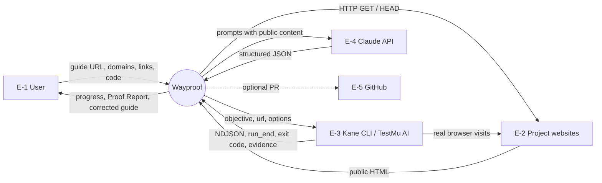
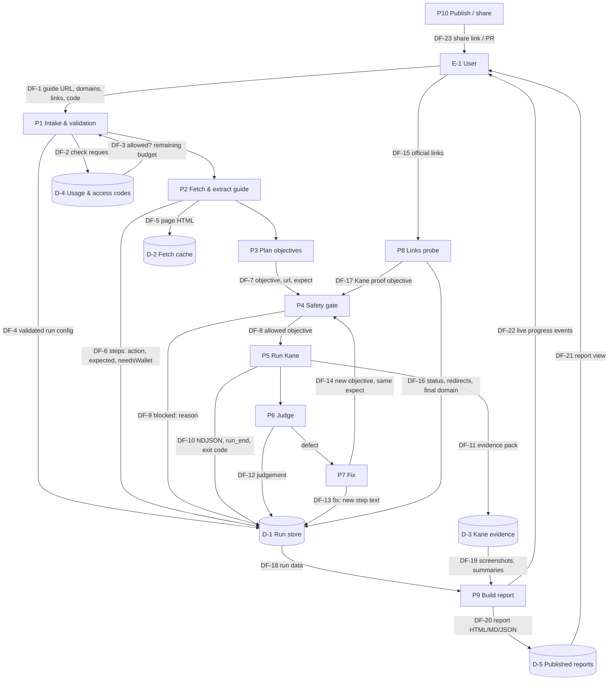
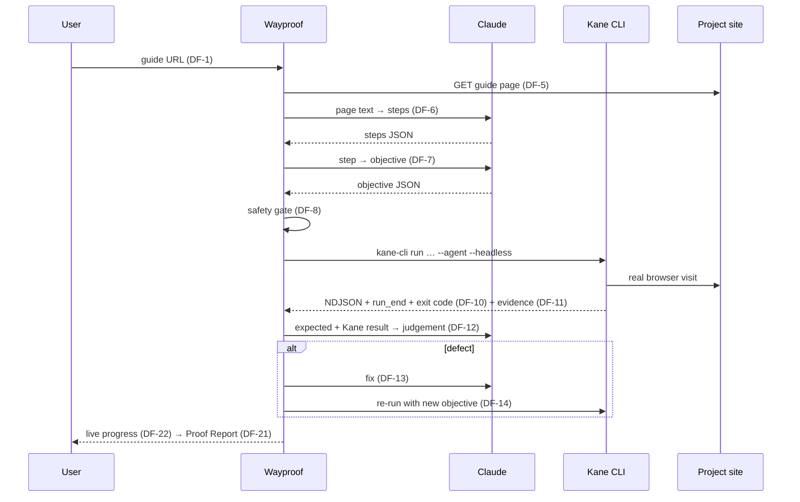

# 05 · Data Flow Documentation — Wayproof

> Part of the [Wayproof documentation set](README.md). Requirements in [04-SRS](04-SRS.md); components (`C-`) in [TDD.md](../TDD.md).
> Labels: **[Rule]** · **[Kane doc]** · **[Decided]** · **[Proposed]** · **[TC-n]**.

---

## 1. External entities

| ID | Entity | Gives Wayproof | Gets from Wayproof |
|---|---|---|---|
| E-1 | **User** (web visitor or CLI user) | Guide URL, allowed domains, optional official links, access code (web), `wayproof.yml` (CLI) | Live progress, Proof Report, corrected guide |
| E-2 | **Project websites** (guide pages, dApp pages, official links) — e.g. TC-1 sites | Page HTML (public) | HTTP requests from Wayproof's fetcher; browser visits from Kane |
| E-3 | **Kane CLI** (local process) + **TestMu AI** (its account/cloud) | NDJSON events, `run_end`, exit code, evidence pack, optional `test_url` **[Kane doc]** | Objective text, start URL, run options; uses the Kane account's credits |
| E-4 | **Anthropic API (Claude)** **[Decided]** | Structured JSON answers (steps, objectives, judgements, fixes) | Guide text, expected results, Kane summaries/remarks (public content only) |
| E-5 | **GitHub** (optional, CLI) | — | Pull request with corrected guide (only if the user asks) |

What Kane itself sends to TestMu AI's cloud during a run is **TC-5**.

---

## 2. Level 0 — context diagram

---

## 3. Level 1 — processes and data stores

---

## 4. Data flows (dictionary)

| ID | From → To | Data | Format | Validation / rule |
|---|---|---|---|---|
| DF-1 | User → P1 | Guide URL, allowed domains, official links, access code | Web form / `wayproof.yml` | 04-SRS §4; FR-1, FR-3, FR-4, FR-6 |
| DF-2/3 | P1 ↔ D-4 | Visitor key (see §6), code hash, run counts | Record | BR-9, BR-10, TC-10 |
| DF-4 | P1 → D-1 | Run config: id, created time, guide URL, domains, links, budget | `run.json` | Schema-validated |
| DF-5 | P2 → D-2 | Fetched page | HTML + extracted text | Fetch timeout [Proposed] 20 s |
| DF-6 | P2 → D-1 | Steps `{n, action, expected, needsWallet}` | JSON (Claude, schema) | FR-2; empty → ERR-NO-STEPS |
| DF-7 | P3 → P4 | Objective text, start URL, expected result | JSON (Claude, schema) | FR-20 |
| DF-8 | P4 → P5 | Allowed objective | String + options | BR-1, BR-2, FR-26 |
| DF-9 | P4 → D-1 | Blocked check + reason | JSON | `ERR-BOUNDARY` / outside domains |
| DF-10 | P5 → D-1 | NDJSON events, `run_end` (`status, summary, final_state, duration, credits_consumed, session_dir, run_dir, test_url`, plus `reason_code`, `run_id` …), exit code. Docs say `credits`; the real field is `credits_consumed` **[Observed]** (TDD.md §13.1). Unknown event types are ignored | NDJSON + JSON **[Kane doc]**/**[Observed]** | Missing `run_end` → ERR-KANE |
| DF-11 | P5 → D-3 | Evidence pack (steps, screenshots, console/network logs, failure records) | `.evidence` **[Kane doc]** | Linked from every verdict (BR-8) |
| DF-12 | P6 → D-1 | `{outcome, reason, failingStep}` | JSON (Claude, schema) | FR-22 |
| DF-13 | P7 → D-1 | `{newStepText, rationale}` | JSON (Claude, schema) | BR-5 (expect unchanged) |
| DF-14 | P7 → P4 | New objective, same expected result | JSON | Loop max 3 attempts (BR-4) |
| DF-15 | User → P8 | Official links | Form / yml | FR-4 |
| DF-16 | P8 → D-1 | Status code, redirect chain, final domain | JSON | FR-40 |
| DF-17 | P8 → P4 | Kane proof objective for a link | JSON | FR-41 |
| DF-18/19 | D-1, D-3 → P9 | Run data, evidence references | JSON, files | — |
| DF-20 | P9 → D-5 | Report | HTML, Markdown, JSON | BR-7, BR-12 |
| DF-21 | D-5 → User | Report page | HTML | Read-only |
| DF-22 | P9 → User | Live progress events | Server-Sent Events (web) / terminal lines (CLI) | NFR-3 |
| DF-23 | P10 → User / GitHub | Share link; optional PR | URL; Git branch + PR | FR-52; PR only on request |

---

## 5. Data stores

| ID | Store | Holds | CLI location | Web location | Retention |
|---|---|---|---|---|---|
| D-1 | Run store | Run config, steps, attempts, judgements, fixes, verdicts | `.wayproof/runs/<id>/run.json` | Server storage (TC-12) | CLI: user's disk · Web: [Proposed] 30 days unless published |
| D-2 | Fetch cache | Fetched pages | `.wayproof/cache/` | Server temp | Per run |
| D-3 | Kane evidence | Evidence packs, screenshots | Kane's session folder `~/.testmuai/kaneai/sessions/<id>/evidence/` — path read from the `coverage` event's `pack` **[Observed]** (docs say `.testmuai/evidence/` **[Kane doc]**), copied/linked into the run folder | Server storage (TC-12) | Same as D-1 |
| D-4 | Usage & access codes | Visitor run counts, code hashes and limits | — (CLI has no limits) | Server storage | Counters daily [Proposed]; codes until expiry |
| D-5 | Published reports | Report HTML/MD/JSON | `.wayproof/runs/<id>/` | Server storage + public URL | Until removed by the operator |

---

## 6. Data classification and access

| Data | Class | Who can read | Notes |
|---|---|---|---|
| Guide content, page HTML | Public | Anyone with the report | Comes from public pages |
| Kane evidence (screenshots, logs) | Public-derived | Anyone with the report | Of public pages; no wallet, no logins (BR-1) |
| Claude outputs | Public-derived | Anyone with the report | — |
| Access codes | Secret | Operator only | Stored **hashed** |
| Visitor key for limits | Internal | Server only | [Proposed] hashed IP + day; never shown in reports (BR-7) |
| `ANTHROPIC_API_KEY`, Kane login, `GITHUB_TOKEN` | Secret | The process only | Environment variables / Kane's own credential store **[Kane doc: ~/.testmuai/kaneai/profiles/…/credentials]**; never logged, never sent to Claude |

---

## 7. Error and failure data paths

| Failure | Detected in | Stored as | Shown as |
|---|---|---|---|
| Invalid input | P1 | Not stored | `ERR-URL-INVALID` / `ERR-DOMAIN-INVALID` |
| Fetch failed | P2 | Run marked failed (intake) | `ERR-FETCH` |
| No steps | P2 | Run marked failed (intake) | `ERR-NO-STEPS` |
| Claude invalid output (after 1 retry) | P2/P3/P6/P7 | Check verdict `error` | `ERR-AI` |
| Wallet / domain boundary | P4 | Check verdict `blocked` | `ERR-BOUNDARY` / outside domains |
| Kane exit 2, or 3 twice | P5 | Check verdict `couldnt_check` + raw output | `ERR-KANE` / `ERR-KANE-TIMEOUT` |
| Budget reached | P1/P5 | Remaining checks `not_run` | `ERR-BUDGET` |
| Browser disconnects (web) | P9 (SSE) | Nothing lost (run continues server-side) | Reconnecting banner |

---

## 8. Sequence — one guide step through the system

